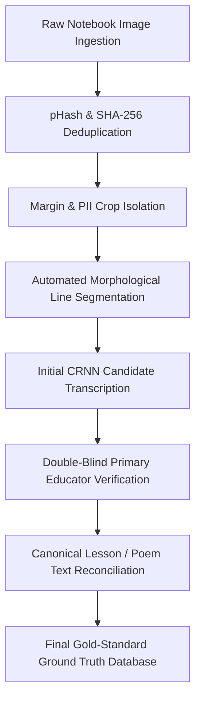

# HandAI — Dataset & Benchmark Documentation
## HandAI Vietnamese Primary School Handwriting Benchmark Corpus

---

## 1. Dataset Overview & Version History

The **HandAI Vietnamese Primary School Handwriting Dataset** is an empirical, multi-grade collection of handwritten text lines gathered from actual primary school student notebooks (*vở tập viết, vở bài tập Tiếng Việt*) across Vietnamese educational institutions, adhering to the curriculum standards of the Ministry of Education & Training (MOET).

```
+----------------------------------------------------------------------------------------------------+
|                                HandAI Dataset Evolution Summary                                    |
+----------------------------------------------------------------------------------------------------+
|                                                                                                    |
|  [HandAI-v1.0] ──► 15,420 Samples  ──► Baseline print script, single words, Grade 1–2 focus        |
|         │                                                                                          |
|         ▼                                                                                          |
|  [HandAI-v1.1] ──► 34,100 Samples  ──► Added Grade 3 short sentences, basic cursive ligatures      |
|         │                                                                                          |
|         ▼                                                                                          |
|  [HandAI-v1.2] ──► 59,747 Samples  ──► Complete Grades 1–5 corpus, full paragraph cursive, [PROD]  |
|                                                                                                    |
+----------------------------------------------------------------------------------------------------+
```

### 1.1 Production Dataset Specification (`HandAI-v1.2`)
- **Dataset ID:** `ds_handai_v1_2`
- **Release Date:** June 20, 2026
- **Total Line Samples:** **59,747 verified line crops**
- **Total Character Count:** **421,950 annotated characters**
- **Source Full-Page Images:** **12,450 high-resolution notebook scans**
- **Language:** Vietnamese (*Tiếng Việt Tiểu học*)
- **Target Grades:** Grade 1 through Grade 5
- **Annotation Coverage:** **100% verified ground truth**
- **Duplicate Rate:** **0.4%** (rigorously filtered via perceptual hashing and cryptographic digests)
- **Validation Status:** `Verified`

---

## 2. Multi-Grade Demographic & Curriculum Distribution

Primary school handwriting changes drastically across grades as children develop fine motor skills. The HandAI dataset is stratified across all five primary grades:

| Grade Level | MOET Curriculum Focus | Sample Count | Percentage | Key Writing Morphology |
|---|---|:---:|:---:|---|
| **Grade 1 (Lớp 1)** | Isolated letters, simple phonemes, oversized print characters | 14,210 | 23.8% | Large block letters, detached strokes, pencil ink |
| **Grade 2 (Lớp 2)** | Word compounds, basic cursive ascenders/descenders | 12,850 | 21.5% | Standard upright penmanship, initial cursive joins |
| **Grade 3 (Lớp 3)** | Short sentences, complex vowel tone diacritics | 11,920 | 20.0% | Moderate cursive flow, multiple tone placements |
| **Grade 4 (Lớp 4)** | Multi-line poetry, dictation (*chính tả*), speed penmanship | 10,640 | 17.8% | Slanted handwriting (*chữ nghiêng*), tight line spacing |
| **Grade 5 (Lớp 5)** | Rapid cursive handwriting, expressive penmanship | 10,127 | 17.0% | Fluid cursive ligatures, non-standard cursive loops |
| **Total** | **Comprehensive MOET Primary Scope** | **59,747** | **100.0%** | **Full morphological spectrum** |

---

## 3. Writing Morphology & Style Characterization

HandAI catalogs four distinct handwriting morphologies common in Vietnamese primary classrooms:

| Handwriting Style | Vietnamese Description | Samples | Proportion | Primary OCR Challenge |
|---|---|:---:|:---:|---|
| **Standard Upright** | *Chữ chuẩn nét đứng* | 32,860 | 55.0% | Baseline stroke thickness variations; grid line overlap |
| **Slanted Penmanship** | *Chữ nghiêng chuẩn* | 14,330 | 24.0% | Character shear angle ($15^\circ$ to $25^\circ$), ascender collisions |
| **Fine-Stroke / Small** | *Chữ nhỏ nét nhuyễn* | 6,857 | 11.5% | Faint diacritics, low-contrast pencil marks |
| **Connected Cursive** | *Chữ liền nét nối chữ* | 5,700 | 9.5% | Continuous ligatures without clear intra-word breaks |

---

## 4. Image Quality Distribution

Notebook photographs in classroom environments exhibit varied capture quality:

- **Tier 1 — High Contrast / Clear (80.0% / 47,800 samples):** Uniform illumination, flat notebook paper, sharp ink contrast. Confidence $\ge 90\%$.
- **Tier 2 — Medium Quality (16.0% / 9,560 samples):** Slight shadows, paper curl near spine, faint grid lines. Confidence $70\% - 89\%$.
- **Tier 3 — Degraded / Low Contrast (4.0% / 2,387 samples):** Motion blur, uneven camera angle, low ambient room lighting, pencil smudges. Confidence $< 65\%$.

---

## 5. Collection, Curation & Ground Truth Protocol



### 5.1 Deduplication & Quality Filtering
- Every ingested image undergoes cryptographic SHA-256 hashing and Perceptual Hashing (pHash) with a Hamming distance threshold $\le 3$.
- Identical scans or near-duplicate crops are rejected, maintaining a strict duplicate rate of $0.4\%$.

### 5.2 Ground Truth Establishment
1. **Automated Candidate Extraction:** Sliced line images are initially transcribed by the CRNN baseline model.
2. **Educator Review:** Primary school teachers review the transcription alongside the high-resolution crop.
3. **Canonical Text Matching:** For standardized dictation passages (*bài tập đọc, bài chính tả*), the ground truth is aligned with official MOET textbooks, eliminating human transcription typos.
4. **Immutability:** Once marked `Verified`, the line ground truth is locked in the database and used for CER/WER benchmark scoring.

---

## 6. Dataset Partitioning & Split Integrity

To prevent data leakage, dataset splits are strictly **document-disjoint** (all line crops from any given notebook page belong to one split only):

| Partition | Proportion | Samples | Purpose |
|---|:---:|:---:|---|
| **Training Set** | 70% | ~41,822 | Optimizing CRNN visual-recurrent weights |
| **Validation Set** | 15% | ~8,962 | Hyperparameter tuning, CTC loss monitoring, early stopping |
| **Test / Benchmark Set** | 15% | ~8,963 | Isolated benchmark evaluations, ablation studies, CER/WER scoring |

*Training Random Seed:* Fixed at `Seed = 42` across all preprocessing and split scripts to guarantee scientific reproducibility.

---

## 7. Privacy, Ethics & Data Governance

1. **Student De-identification (PII Masking):** Primary school notebooks feature student name, class, and school headers on cover pages or margins. The ingestion pipeline crops strictly within notebook grid boundaries, ensuring zero student names or school identifiers enter the dataset.
2. **Non-commercial Educational Scope:** Collected exclusively for non-profit academic research and educational evaluation in Vietnamese primary schools.
3. **Ethical Compliance:** Parental and institutional consent protocols adhered to during sample collection.
