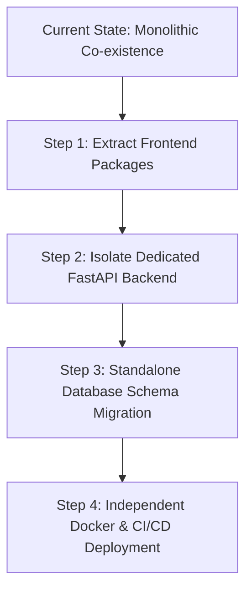

# HandAI — System Limitations & Future Research Roadmap
## Architectural Constraints, Known Failure Modes & Strategic Evolutions

---

## 1. Current System Limitations

While HandAI achieves state-of-the-art accuracy ($94.0\%$ Line Accuracy, $5.0\%$ CER) on Vietnamese primary school handwriting, rigorous empirical analysis reveals specific physical, algorithmic, and architectural constraints.

### 1.1 Handwriting Diversity & High-Order Cursive Ligatures
- **Extreme Cursive Fluidity (Grades 4–5):** Older primary students write at higher speeds, resulting in continuous ligatures (*chữ liền nét*) where letter boundaries merge completely (e.g., joined sequences like `uyên`, `uông`, `ngh`). The fixed temporal resolution ($T = 128$) of the CRNN model occasionally produces character dropouts (deletion errors) when multiple cursive loops are compressed into fewer feature frames.
- **Non-Standard Grip Variance:** Students who exhibit atypical pencil grip angles introduce severe baseline tilt and inconsistent slant angles exceeding $\pm 30^\circ$, which exceeds the standard deskew correction threshold ($15^\circ$).

### 1.2 Diacritical Sensitivity & Low-Contrast Inputs
- **Faint Pencil Diacritics:** In Grade 1 notebooks, students predominantly use soft graphite pencils (2B/HB). If lighting is uneven or camera focus is soft, small accents—such as the dot below (*nặng* - `\u0323`) or the hook above (*hỏi* - `\u0309`)—exhibit low pixel intensity and are absorbed by morphological binarization filters, leading to `VIETNAMESE_TONE_ERROR`.
- **Pre-printed Ruled Paper Grid Interference (*Vở ô ly*):** Vietnamese student notebooks feature bold square grids (*ô ly 4 ly, 5 ly vuông*). In cases where grid lines share the same ink color (blue or purple) as student fountain pens, horizontal projection profiles occasionally detect grid lines as false candidate rows.

### 1.3 Latency & Cloud Dependency of LLM Post-Correction
- **End-to-End Latency Overhead:** While the local CRNN model executes in $<250\text{ ms}$, invoking cloud LLMs (Groq Llama-3.3-70b or Google Gemini-4B) introduces network round-trips of $1.5\text{ to } 3.0\text{ seconds}$, depending on regional internet bandwidth.
- **Offline Limitation:** The current AI post-correction arbitration layer requires active internet connectivity. In disconnected offline classroom environments, the system must operate in `Fast-Path` CRNN-only mode, sacrificing the $+12.0\%$ accuracy gain provided by the LLM safety net.

### 1.4 Monorepo Coupling with MathVisionKid
- **Shared Infrastructure Overlap:** HandAI currently shares its database container, MinIO object store, and Spring Boot server process with the parent MathVisionKid arithmetic grading application. While this simplifies deployment for a combined capstone, it prevents independent horizontal scaling of the OCR service.

---

## 2. Strategic Future Research Roadmap

```
+────────────────────────────────────────────────────────────────────────────────────────────────────+
|                                    HandAI Future Evolution Roadmap                                 |
+────────────────────────────────────────────────────────────────────────────────────────────────────+
|                                                                                                    |
|  [Phase A: On-Device Quantization]  ──► CoreML / TFLite 8-bit quantized models (<15MB, on-device)  |
|               │                                                                                    |
|               ▼                                                                                    |
|  [Phase B: Vision Transformer]      ──► TrOCR / ViT-based line recognition (attention over CTC)    |
|               │                                                                                    |
|               ▼                                                                                    |
|  [Phase C: Local SLM Correction]    ──► On-device 1B-parameter Vietnamese Small Language Model      |
|               │                                                                                    |
|               ▼                                                                                    |
|  [Phase D: Microservice Decoupling] ──► Standalone HandAI Microservice & Independent Docker Repo   |
|                                                                                                    |
+────────────────────────────────────────────────────────────────────────────────────────────────────+
```

### 2.1 Edge & On-Device Neural Acceleration (CoreML / ONNX / TFLite)
- **Quantization:** Quantize the CRNN model weights from Float32 (24MB) to INT8 (6MB) via PyTorch Dynamic Quantization.
- **On-Device Inference:** Export the INT8 model to Apple CoreML (for iOS / iPadOS) and TensorFlow Lite / ONNX Runtime (for Android).
- **Benefit:** Eliminates network transport latency for line recognition, enabling 100% offline handwriting recognition in remote rural primary schools without internet access.

### 2.2 Next-Generation Vision Transformer Architecture (TrOCR)
- **Limitations of BiLSTM:** LSTMs suffer from sequential bottlenecking and limited receptive fields across complex cursive ligatures.
- **Proposed Architecture:** Transition to an encoder-decoder Vision Transformer (TrOCR) pre-trained on Vietnamese document text. The self-attention mechanism attends directly to diacritics situated far above base letters, eliminating detached tone errors at the architectural level.

### 2.3 On-Device Small Language Model (SLM) for Offline Correction
- Replace cloud API dependencies (Groq/Gemini) with an edge-optimized Small Language Model (such as a fine-tuned 1B-parameter model like Gemma-2-2B or Qwen-2.5-1.5B quantized via GGUF/llama.cpp).
- Run on-device contextual phonotactic correction in $<500\text{ ms}$, preserving the $+12.0\%$ accuracy gain without requiring external cloud tokens.

### 2.4 Advanced Ruled Paper Grid Subtraction
- Implement a deep morphological U-Net or classical morphological line detector specifically tuned to recognize and erase *vở ô ly* quad lines before projection profile slicing, completely eliminating grid noise.

---

## 3. Microservice Decoupling Plan (Extracting HandAI from MathVisionKid)

To transition HandAI into a completely independent software product or standalone open-source library, the following 4-step decoupling plan is recommended:



1. **Step 1 — Frontend Decoupling:** Extract `apps/student-mobile/src/app/handai-*.tsx` and `services/analytics/handAiAnalyticsStore.ts` into a standalone React Native application or dedicated npm library (`@handai/react-native-sdk`).
2. **Step 2 — Backend Unification:** Migrate the business orchestration logic from Spring Boot directly into the Python FastAPI service, eliminating the Java layer entirely and providing a unified Python-based Computer Vision API.
3. **Step 3 — Database Schema Isolation:** Move Flyway migrations `V11`, `V14`, and `V15` into a dedicated PostgreSQL schema (`handai_db`), removing all foreign key dependencies on MathVision user tables.
4. **Step 4 — Independent Container Packaging:** Package HandAI into a single `docker-compose.yml` comprising:
   - `handai-engine`: Combined FastAPI + PyTorch CRNN runtime.
   - `handai-db`: Dedicated PostgreSQL instance.
   - `handai-storage`: Dedicated MinIO instance.
