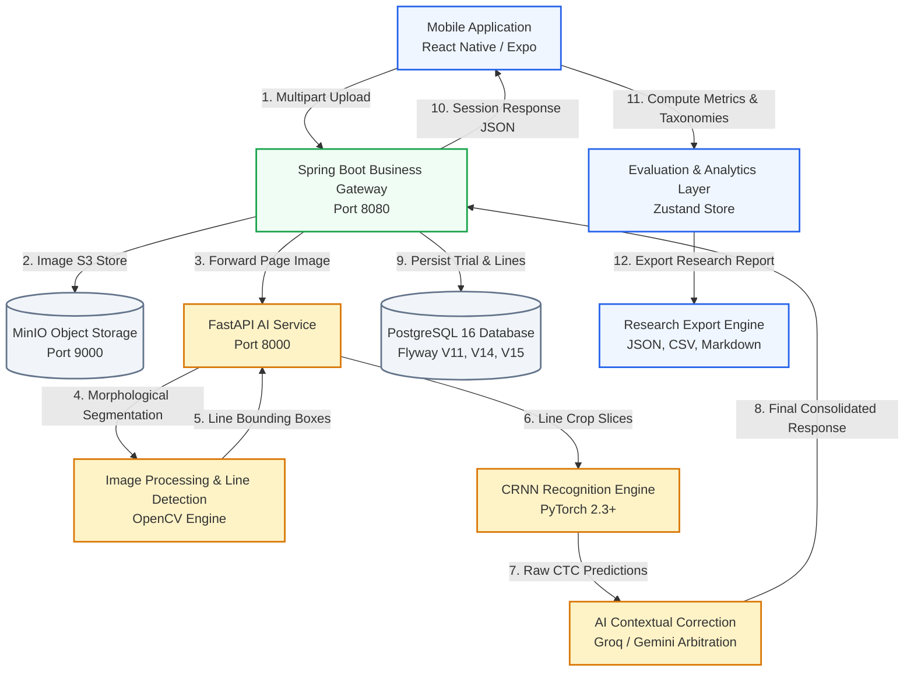
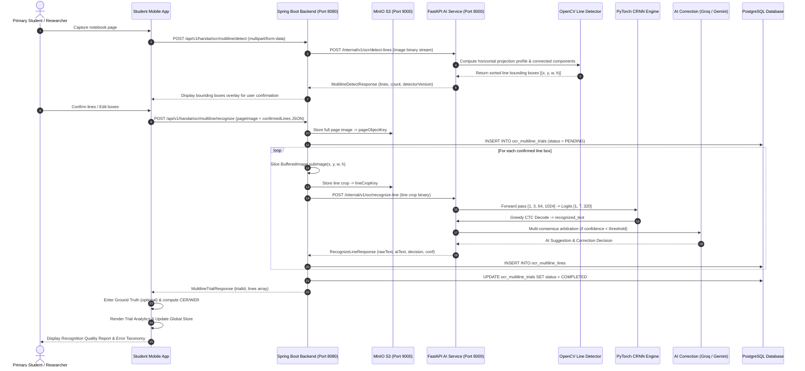

# HandAI — System Architecture & End-to-End Execution Flow
## Vietnamese Primary School Handwriting Recognition System

---

## 1. End-to-End High-Level Architecture

HandAI operates on an asynchronous, multi-tiered service-oriented architecture designed to balance real-time mobile interactivity with high-throughput deep learning inference and academic evaluation integrity.

---

## 2. Architectural Tier Breakdown

### 2.1 Tier 1: Client Layer (Student Mobile Application)
- **Framework:** React Native 0.74+ running on Expo 51, TypeScript.
- **Responsibilities:**
  - High-resolution camera viewfinder capture with aspect ratio guidance and illumination feedback.
  - Interactive bounding box review interface allowing manual adjustment of line coordinates.
  - Real-time client-side evaluation engine calculating CER, WER, and accuracy against ground truth.
  - Multi-session continuous analytics visualization and research artifact generation.
- **Network Interfaces:**
  - `POST /api/v1/handai/ocr/multiline/detect` (Guest demonstration detection)
  - `POST /api/v1/handai/ocr/multiline/recognize` (Guest demonstration trial recognition)
  - `POST /api/v1/ocr/multiline/*` (Authenticated user OCR operations)

### 2.2 Tier 2: Business & Orchestration Layer (Spring Boot 3.3)
- **Framework:** Java 21, Spring Boot 3.3.0, Spring Data JPA, Hibernate, Flyway.
- **Responsibilities:**
  - Gateway security and guest session isolation (rate limiting, file size enforcement $\le 10\text{ MB}$, MIME validation).
  - Cryptographic data integrity verification (calculating SHA-256 hashes of raw pages and individual line crops).
  - Object storage orchestration with MinIO (`ocr-trials/multiline/`).
  - Slicing sub-images based on confirmed bounding box coordinates $(x, y, w, h)$.
  - Transactional persistence of trials, lines, error records, and experiment tracking metadata.
- **Network Interfaces:**
  - Internal proxying to AI Service at `http://localhost:8000/internal/v1/ocr/*` authenticated via `X-Internal-API-Key`.

### 2.3 Tier 3: AI Inference & Computer Vision Layer (FastAPI Service)
- **Framework:** Python 3.10+, FastAPI, PyTorch 2.3+, OpenCV 4.9+, Pillow, NumPy.
- **Responsibilities:**
  - **Classical Morphology & Line Segmentation (`/internal/v1/ocr/detect-lines`):** Identifies text line polygons using grayscale conversion, adaptive thresholding, and horizontal projection profiles.
  - **Acoustic/Visual Line Recognition (`/internal/v1/ocr/recognize-line`):** Feeds normalized $[3 \times 64 \times 1024]$ line crops through the CRNN model (`best_cer.pth`), performing greedy CTC decoding across the 320-character vocabulary.
  - **AI Contextual Correction Arbitration:** Orchestrates LLM prompt execution (Groq Llama-3.3-70b-versatile and Google Gemini-4B) to correct phonotactic and diacritical errors while preserving primary handwriting semantics.

### 2.4 Tier 4: Storage & Data Persistence Layer (Shared Infrastructure)
- **Object Storage (MinIO S3):**
  - Bucket: `mathvision`
  - Paths:
    - Raw notebook pages: `ocr-trials/multiline/{timestamp}_{sha256}.jpg`
    - Sliced line crops: `ocr-trials/multiline/crops/line_{sha256:16}.jpg`
- **Relational Database (PostgreSQL 16):**
  - Tables:
    - `ocr_multiline_trials`: Master trial metadata, user attribution, resolution, image hashes.
    - `ocr_multiline_lines`: Bounding box coordinates, raw OCR text, AI text, final text, decision source.
    - `ocr_dataset_versions`: Dataset version metadata, grade distributions, duplicate rates.
    - `ocr_model_experiments`: Model version metadata, hyperparameters, baseline metrics.
    - `ocr_error_records`: Character and word error taxonomy events.
    - `ocr_ai_impact_metrics`: Raw vs. final accuracy gains and error rescue rates.
    - `ocr_confidence_calibrations`: 5-bin confidence reliability matrices.
    - `ocr_error_root_causes`: 4-category architectural failure classifications.

---

## 3. End-to-End Processing Sequence

---

## 4. Network Contracts & Boundary Isolation

### 4.1 Client-to-Backend Contract (Public / Guest)
- **Path:** `/api/v1/handai/ocr/multiline/*`
- **Security:** Public guest access enabled for research demonstrations. Rate-limited to prevent Denial of Service.
- **Content Type:** `multipart/form-data` with binary image file and optional JSON metadata.

### 4.2 Backend-to-AI Service Contract (Internal Protected)
- **Path:** `/internal/v1/ocr/*`
- **Security:** Strict header-based authentication via `X-Internal-API-Key: secret-key-default`. Direct client requests are rejected with `401 Unauthorized`.
- **Payload Format:** Pure binary octet stream (`image/jpeg` or `image/png`). JSON payloads are rejected with `415 Unsupported Media Type` to optimize serialization throughput.

---

## 5. Architectural Quality Attributes

1. **Deterministic Reproducibility:** Every evaluated line links directly to its source checkpoint hash (`best_cer.pth` SHA-256: `a807eaa7...`), vocabulary hash, and preprocessing configuration (`v1_resize_64x1024_imagenet`).
2. **Graceful Degradation:** If cloud LLM services (Groq or Gemini) encounter rate limits or timeouts, the system falls back to the local CRNN prediction with zero downtime (`DecisionSource = CRNN`).
3. **Data Anonymization & Privacy:** No student personal identifiable information (PII) is transferred to the OCR or LLM layers. Images are cropped to exclude notebook header margins containing student names and school identifiers before recognition.
4. **Sub-second Edge Responsiveness:** Line detection executes in $<300\text{ ms}$, while CRNN line inference executes in $<50\text{ ms}$ on GPU or $<250\text{ ms}$ on standard multi-core CPU.
