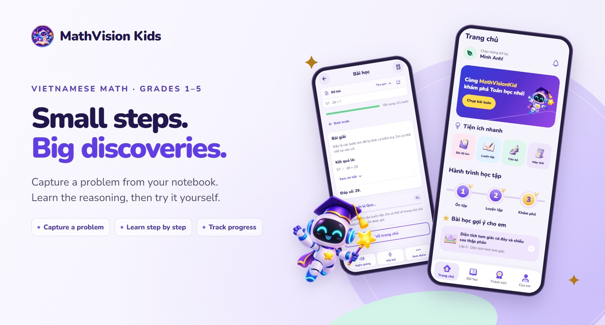
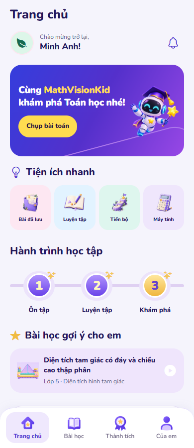
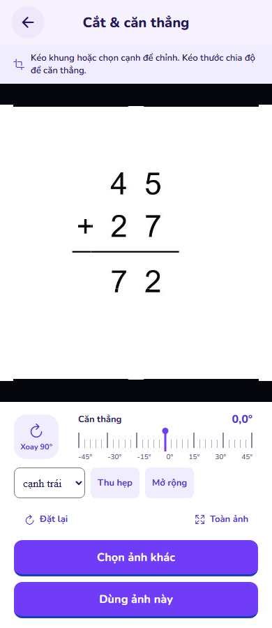
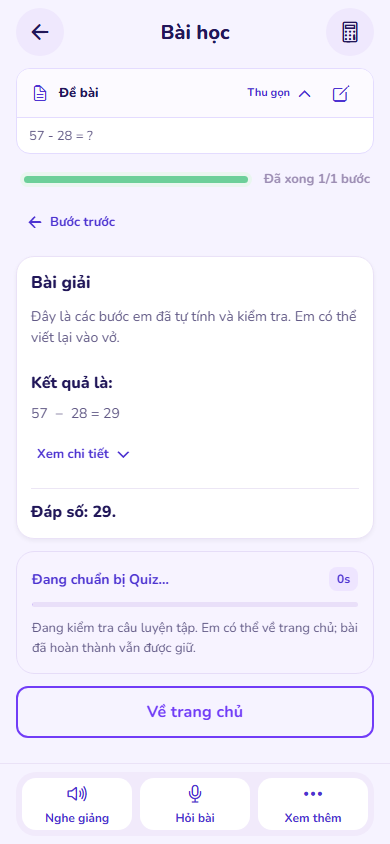
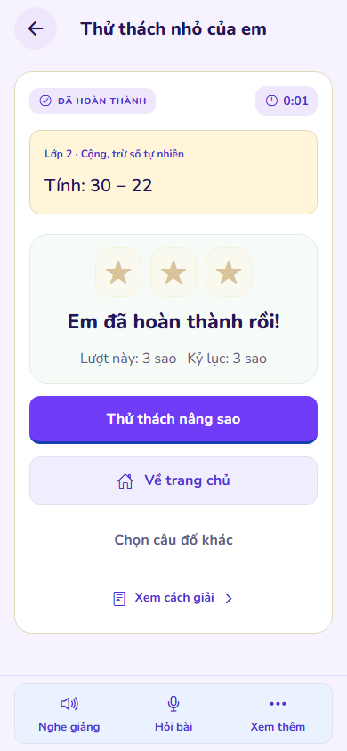
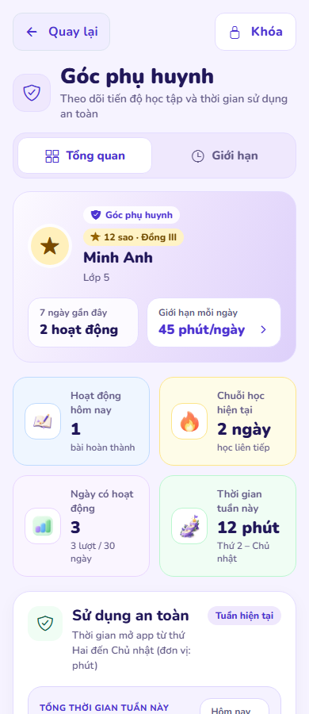

# MathVision Kids

### From a notebook photo to a lesson the student can work through.

A Vietnamese math learning app for grades 1–5. Students can photograph a problem, check the recognized text, and work through the reasoning with hints and narration. Families can follow learning activity and set time limits in Parent Mode.

[Open MathVision Kids](https://edu.mathvision.online) · [Screenshots](#see-it-in-action) · [Run locally](#run-it-locally) · [Vietnamese setup](docs/HUONG_DAN_CAI_DAT.md) · [Architecture](docs/ARCHITECTURE_LOCAL_RUNTIME.md)

---

## A little more confidence, one step at a time

Students can start with a photographed question, review their own handwritten solution, or choose a topic from the practice library. The same website provides the sign-in page and opens the Student workspace after sign-in. Teacher and administrator accounts have separate workspaces.

| Capture with care | Understand the work | Learn by doing |
| :--- | :--- | :--- |
| Open the camera directly, straighten and crop the page, and cover personal information before sending. | Review the problem or detected lines, correct uncertain text, and add the original question when only a solution was photographed. | Answer one question at a time, check a calculation, and revisit completed steps instead of just receiving a final answer. |

## See it in action

### The student journey

<table>
  <tr>
    <td align="center" width="33%"> <strong>1. Start on Student Home</strong> Open the camera, practice by topic, or resume saved work.</td>
    <td align="center" width="33%"> <strong>2. Prepare the photo</strong> Cover personal details and crop to the problem before review.</td>
    <td align="center" width="33%"> <strong>3. Work through the lesson</strong> Try the steps, check the result, and listen to the explanation.</td>
  </tr>
</table>

### Practice and follow progress

<table>
  <tr>
    <td align="center" width="50%"> <strong>4. Try a short challenge</strong> Practice the skill and review the answer.</td>
    <td align="center" width="50%"> <strong>5. Review progress in Parent Mode</strong> See learning activity and set time limits from the student profile.</td>
  </tr>
</table>

The screenshots show the Vietnamese app in a phone-sized browser viewport. Minh Anh is a sample profile. See the [demo walkthrough](docs/DEMO_GUIDE.md).

## From photo to learning

~~~mermaid
flowchart LR
    A[Capture or choose a photo] --> B[Straighten and crop]
    B --> C[Cover personal information]
    C --> D[Review the recognized content]
    D --> E{What is in the photo?}
    E -->|Question| F[Start a guided lesson]
    E -->|Worked solution| G[Add the original question]
    G --> F
    F --> H[Try, check, and save]
~~~

An isolated calculation can be checked arithmetically. Deciding whether an entire solution answers the task requires the original question. The app keeps that distinction explicit.

## What is inside

- **Student app:** direct camera access, photo import, crop and rotation controls, privacy masking, editable reading results, guided lessons, saved work, and learning progress.
- **Parent Mode:** open it from the student's profile to review activity and usage, or set daily and game time limits. The area is protected by a PIN, with email verification for setup and recovery where mail delivery is configured.
- **Account access:** sign in with email and password or Google on Portal. Password recovery uses a verification code sent to the registered email address.
- **Handwriting tools:** line localization, per-line Vietnamese OCR, review of uncertain readings, and optional cloud assistance.
- **Practice library:** browse exercises by grade and topic, then start a guided lesson from the selected problem.
- **Teacher workspace:** classes, assignments, submission batches, and review workflows.
- **Admin workspace:** role-based management through the business API.
- **Catalog Bot:** reuses checked lessons and valid speech privately, with automated storage checks and a visible [GitHub Actions report](https://github.com/NV-DuyManh/MathVisionKid/actions/workflows/lesson-catalog.yml). Open `RUN_CATALOG_BOT.bat` for a read-only snapshot of this machine's catalog; see [catalog details and limits](catalog/README.md).

## Run it locally

The supported launcher workflow is **Windows + PowerShell**. Install **Node.js 22.13+**, **Python 3.12**, **JDK 21**, **Git**, and **Docker Desktop with Compose**. Start Docker Desktop before launching the project.

~~~powershell
git clone https://github.com/NV-DuyManh/MathVisionKid.git
cd MathVisionKid
.\SETUP_MATHVISION.bat
.\RUN_MATHVISION.bat
~~~

On a freshly cloned Windows machine, double-click **`SETUP_MATHVISION.bat`** first. It installs missing prerequisites through WinGet, installs all JavaScript workspaces and locked Python libraries (including speech), prepares FFmpeg, and compiles the backend. Allow the Windows installer prompts when needed. Then open Docker Desktop and run **`RUN_MATHVISION.bat`**. Private cloud keys and model weights are described in the [setup guide](docs/HUONG_DAN_CAI_DAT.md).

Use **`RUN_MATHVISION.bat`** to start the local stack. For the web experience, open [Portal sign-in](http://localhost:5172/login). For Expo Go, keep the launcher terminal open and scan the displayed QR code. Use the addresses printed by the launcher when a port has been configured differently.

The public [MathVision Kids website](https://edu.mathvision.online) serves Portal and Student Web from Vercel and connects to the deployed business API. **`DEPLOY_WEB.bat`** is the separate PC-hosted preview workflow. The preview needs its configured public connection, Docker, and a running PC. See [production deployment](docs/PRODUCTION_DEPLOYMENT.md) and [PC preview setup](docs/PC_PREVIEW_DEPLOYMENT.md).

> **Fresh clone expectations:** source code and model manifests are included; trained weights and API keys are not. The default asynchronous grading mode uses synthetic fixtures. Real handwriting OCR requires the supplied CRNN checkpoint. Reading a photographed math question uses configured cloud vision. Set up those capabilities with the [installation guide](docs/LOCAL_SETUP.md#enable-real-recognition-and-guidance).

| Entry point | Default address or command |
| :--- | :--- |
| Unified web portal | `http://localhost:5172` |
| Teacher workspace | `http://localhost:5173` |
| Admin workspace | `http://localhost:5174` |
| Student app | Scan the launcher QR in a compatible Expo Go client |
| Student Web | `http://localhost:5172/login` → `/study/` |
| Runtime health | `.\scripts\health-check.bat` |
| First-time dependency setup | `.\SETUP_MATHVISION.bat` |
| Stop the local stack | `.\STOP_MATHVISION.bat` |

The local Portal also opens the shared Student interface at `http://localhost:5172/study/` after Portal login. Starting Portal prepares this generated preview automatically and retains the same browser session. Restart Portal after changing Student code to refresh its preview; the separate Expo development app continues to update normally. Generated Student files stay out of Git.

The root launchers have separate purposes: `RUN_MATHVISION.bat` runs the local app, `STOP_MATHVISION.bat` stops it, `RUN_CATALOG_BOT.bat` audits the lesson catalog, and `DEPLOY_WEB.bat` publishes the configured public trial. Maintenance commands live in `scripts/`; their PowerShell implementations live in `scripts/dev/`.

For phone setup, development accounts, model files, and configuration, follow [English setup](docs/LOCAL_SETUP.md) or [Vietnamese setup](docs/HUONG_DAN_CAI_DAT.md). For errors, see [troubleshooting](docs/TROUBLESHOOTING.md).

## Technology stack

| Layer | Technologies | Purpose |
| :--- | :--- | :--- |
| Student experience | Expo SDK 58, React Native 0.88, React 19, TypeScript, Expo Router | Mobile navigation, camera input, and shared web preview |
| Image interaction | Expo Camera, Image Picker, Image Manipulator, Gesture Handler, Reanimated | Capture, crop, rotation, and touch feedback |
| Web workspaces | React, TypeScript, Vite | Portal, teacher, and admin interfaces |
| Business API | Java 21, Spring Boot 3.5, Spring Security, JWT, JPA, Flyway | Authentication, authorization, records, and orchestration |
| AI runtime | Python 3.12, FastAPI, Pydantic, PyTorch, OpenCV | Recognition endpoints, image processing, and lesson logic |
| Local recognition | Vietnamese CRNN, optional PP-OCR text detector, YOLO arithmetic detector | Different models for different recognition tasks |
| Cloud assistance | Groq; configurable Gemini fallback | Notebook reading and assistance where enabled |
| Storage and jobs | PostgreSQL 16, MinIO, Redis 7, Celery | Relational records, image storage, and asynchronous processing |
| Verification | Jest, Pytest, JUnit, TypeScript checks | Mobile, AI, and backend regression checks |

Versions above describe the repository, not a recommendation to upgrade independently of its lockfiles.

## How recognition actually works

| Capability | Current implementation | Required for real use |
| :--- | :--- | :--- |
| Locate handwriting lines | Local image geometry; optional text detector assistance | AI runtime; detector artifact if enabled |
| Read individual handwriting lines | Project CRNN checkpoint, with optional cloud advisors | CRNN weights and vocabulary |
| Read a notebook photo in the main math guide | Cloud vision; local geometry helps place the rows | Valid configured Groq or Gemini access |
| Guide a math lesson | Validated built-in plans for supported patterns; cloud-generated plans for other supported requests | Business API + AI runtime; cloud access for generated plans |
| Grade asynchronous arithmetic submissions | Synthetic fixtures by default; YOLO in model mode | YOLO weights for model mode |

Line detection, transcription, and reasoning are separate tasks. A successful health check or an error-free batch does **not** prove that every line or answer is correct. Difficult handwriting, skew, clutter, and incomplete questions still require review. See the [recognition refinement report (local archive)](report/README.md#local-archive) (`DRIVE_LINE_REFINEMENT_20261005.md`) and [quality notes](docs/ARCHITECTURE_LOCAL_RUNTIME.md#quality-and-current-limits).

## Project map

~~~text
MathVisionKid/
├── apps/                 student-mobile, portal-web, teacher-web, admin-web
├── backend/business-api/ Java / Spring Boot authority
├── ai/runtime/           Python recognition and tutoring services
├── packages/             Shared types and brand resources
├── contracts/            API contracts
├── infra/docker/         Local infrastructure
├── scripts/              Launch, health, and stop commands
├── docs/                 Setup, usage, architecture, and demo media
└── report/               Local evidence and minimal tracked receipts
~~~

## Documentation

| I want to… | Read this |
| :--- | :--- |
| Install and run the project | [Local setup](docs/LOCAL_SETUP.md) · [Vietnamese setup](docs/HUONG_DAN_CAI_DAT.md) |
| Deploy the web workspaces | [Vercel and production setup](docs/PRODUCTION_DEPLOYMENT.md) · [API/OCR trial on your PC](docs/PC_PREVIEW_DEPLOYMENT.md) |
| Clone on another computer or understand the shared link | [Clone and hosting behavior](docs/CLONE_AND_HOSTING.md) · [Free cloud trial](docs/FREE_CLOUD_DEPLOYMENT.md) |
| Review the shared student website | [Student web parity and verification (local archive)](report/README.md#local-archive) (`student-web-parity-2026-10-09.md`) |
| Understand how a student uses it | [User guide](docs/USER_GUIDE.md) |
| Present the app and view all demo images | [Demo walkthrough](docs/DEMO_GUIDE.md) |
| Understand services and AI boundaries | [Architecture](docs/ARCHITECTURE_LOCAL_RUNTIME.md) |
| Fix startup, phone, or recognition issues | [Troubleshooting](docs/TROUBLESHOOTING.md) |
| Review labels and evaluate a local OCR candidate | [OCR review and training](docs/OCR_REVIEW_AND_TRAINING.md) |
| Check the latest app on a physical phone | [Phone test checklist](docs/PHONE_TEST_HANDOFF.md) |
| Contribute and run checks | [Contributing](CONTRIBUTING.md) |

## Contributing and license

MathVision Kids includes contributions from **Kha, Nam, Lộc, Hiếu, and Nguyễn Văn Duy Mạnh**. See [contributors and source history](CONTRIBUTORS.md) for the verified scope and original commits.

Focused improvements, reproducible bug reports, and carefully reviewed recognition examples are welcome. Start with [CONTRIBUTING.md](CONTRIBUTING.md). Keep credentials, student photos, datasets, checkpoints, and runtime logs out of Git.

The repository includes an [MIT license](LICENSE). Retain existing copyright notices and third-party licenses, including the bundled [Nunito font license](apps/student-mobile/assets/fonts/OFL.txt).

**Understand the problem. Try a small step. Grow a little more confident.**

[Back to top](#mathvision-kids)

