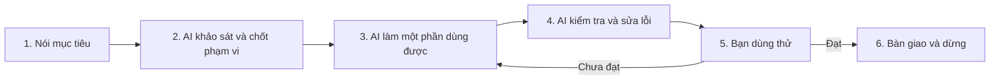

# Workflow vibe coding cho người không biết code

Áp dụng trước cho MathVision Kids; có thể dùng lại ở dự án khác bằng cách thay tên và quy tắc dự án. Ngày soạn: 27/10/2026 (Asia/Saigon).

**Bạn quyết định sản phẩm cần làm gì. AI chịu trách nhiệm tìm hiểu code, chọn skill, triển khai và đưa bằng chứng kiểm tra.** Bạn không cần nhớ tên skill hoặc tự chạy lệnh.

## Bắt đầu bằng mẫu này

Dán vào chat khi muốn làm một việc cụ thể. Chỉ cần điền phần trong ngoặc vuông.

```text
Tôi không biết code. Hãy dùng docs/VIBE_CODING_WORKFLOW.vi.md
và tuân thủ AGENTS.md của dự án.

Tôi muốn: [kết quả người dùng nhìn thấy hoặc làm được].
Ai sử dụng: [học sinh / giáo viên / quản trị / người khác].
Phạm vi: [web / mobile / backend / phần cụ thể].
Ví dụ sử dụng: [mở đâu → bấm gì → mong thấy gì].
Làm xong khi:
1. [điều kiện có thể thử bằng thao tác].
2. [điều kiện thứ hai].
3. [điều kiện thứ ba].
Điều cần giữ: [màn hình, dữ liệu hoặc hành vi cần bảo toàn].

Hãy tự khảo sát hiện trạng và chọn skill phù hợp.
Nếu yêu cầu đã rõ, thực hiện trong phạm vi này đến khi đã kiểm tra.
Nếu còn quyết định làm thay đổi trải nghiệm, phạm vi hoặc dữ liệu,
giải thích ngắn và hỏi tôi điều cần quyết định trước khi làm phần phụ thuộc.
Đừng hỏi lại việc tôi đã cho phép hoặc bắt tôi chọn kỹ thuật mà bạn có thể tự xác định.

Bàn giao: bản xem thử nếu có giao diện, kết quả kiểm tra thực tế,
3–5 thao tác để tôi nghiệm thu, điều chưa kiểm chứng và cách quay lại an toàn.
Không tự commit/push, triển khai lên môi trường thật hoặc huấn luyện mô hình
khi tôi chưa cho phép rõ các việc đó.
```

Nếu chưa biết mình muốn màn hình như thế nào: gửi ảnh tham khảo và nói rõ phần thích, phần không muốn. AI phải phân biệt nội dung tham khảo với chỉ dẫn bạn thực sự đưa ra.

## Sáu bước cho mỗi việc



| Bước | Bạn làm gì | AI phải giao gì | Khi nào chuyển bước |
|---|---|---|---|
| 1. Nói mục tiêu | Mô tả ai gặp khó khăn gì và kết quả mong muốn | Viết lại yêu cầu bằng tiếng Việt dễ hiểu | Có ví dụ và điều kiện nghiệm thu quan sát được |
| 2. Khảo sát | Trả lời câu hỏi về sản phẩm nếu thật sự thiếu thông tin | Hiện trạng, phạm vi sửa, phần liên quan, skill sẽ dùng, cách kiểm tra | Việc rõ thì tiếp tục; tính năng mới hoặc lựa chọn ảnh hưởng lớn cần chốt cách hoạt động |
| 3. Làm | Xem bản xem thử khi cần quyết định hình thức | Một phần hoạt động từ đầu đến cuối; tái sử dụng cấu trúc có sẵn | Có luồng chính để kiểm tra, không chỉ có ảnh đẹp |
| 4. Kiểm tra | Không cần tự đọc log | Chạy kiểm tra phù hợp, thử tình huống lỗi, sửa lỗi do thay đổi; cung cấp kết quả | Điều kiện đã đạt hoặc nêu rõ điều đang bị chặn |
| 5. Dùng thử | Làm 3–5 thao tác AI hướng dẫn; phản hồi điều nhìn thấy | Đối chiếu từng tiêu chí với bằng chứng và phản hồi của bạn | Bạn xác nhận trải nghiệm phù hợp; phần thiếu quay lại đúng phạm vi |
| 6. Bàn giao | Quyết định có lưu lịch sử/chia sẻ/đưa lên môi trường thật hay chưa | Tóm tắt thay đổi, kết quả, giới hạn, cách phục hồi và việc tiếp theo nếu còn | Báo cáo xong rồi dừng, không tự mở rộng nhiệm vụ |

Với sửa chữ, khoảng cách hoặc lỗi nhỏ đã rõ: khảo sát → sửa → kiểm tra → báo cáo trong một lượt. Với tính năng mới nhiều màn hình: chốt mục tiêu và trải nghiệm trước, chia thành các phần nhỏ. Bạn chỉ cần duyệt quyết định có ý nghĩa, không cần duyệt từng tệp.

## Một đầu mối, các vai trò theo từng bước

Mặc định dùng một chat Codex làm đầu mối. Trong chat đó, AI lần lượt làm vai trò làm rõ yêu cầu, thiết kế, lập trình và kiểm tra.

Chỉ sử dụng agent bổ sung khi bạn yêu cầu hoặc quy tắc/skill áp dụng thực sự yêu cầu. Một lần tự rà soát trong cùng chat không được gọi là “review độc lập”. Khi cần người/agent khác review, phải nói rõ ai review, phạm vi và kết quả; agent chính vẫn phải kiểm chứng kết quả.

Bạn chưa cần thêm Orca-cli, Spec-kit hoặc nhiều nhà cung cấp model để bắt đầu. Bộ hiện có đủ để thực hiện vòng làm việc cơ bản. Chọn model hiện có trong tài khoản theo độ khó: việc rõ và nhỏ dùng cấu hình thông thường; kiến trúc, lỗi khó và quyền truy cập cần khả năng suy luận tốt hơn. Đánh giá qua kết quả thực tế; không mặc định model rẻ hoặc nhiều agent sẽ tiết kiệm hơn.

## AI chọn skill như thế nào

Bảng này dành cho AI; bạn có thể yêu cầu bằng ngôn ngữ bình thường. Chọn theo từng nhiệm vụ nhỏ, mặc định tối đa 3 skill phù hợp theo quy tắc dự án, không nạp toàn bộ bảng.

| Bạn nói | Skill/nhóm phù hợp đã có | Lưu ý |
|---|---|---|
| “Tôi muốn thêm tính năng nhưng chưa rõ” | Superpowers: `brainstorming`, sau khi rõ mới `writing-plans` | Chốt hành vi người dùng trước; tài liệu ngắn tương xứng với việc |
| “Làm giao diện web này dễ dùng hơn” | `ui-ux-pro-max`, `vercel-react-best-practices`; thêm `fixing-accessibility` khi có tương tác/form | Dùng hệ giao diện đang có; không tự chuyển sang shadcn/Tailwind |
| “Kiểm tra giao diện web có vấn đề gì” | `web-design-guidelines`, `fixing-accessibility` | Checklist web; không coi là kiểm tra đầy đủ ứng dụng native |
| “Màn hình bị giật” | `fixing-motion-performance` cho CSS/DOM | Với mobile phải đo và kiểm tra theo React Native/Expo |
| “Bấm nút này bị lỗi” | `systematic-debugging`; chọn thêm skill triển khai/kiểm tra đúng phạm vi | Tái hiện lỗi, tìm nguyên nhân, rồi sửa |
| “Làm gọn, đừng thêm thứ không cần” | `ponytail`; `ponytail-review` khi review | Giữ kiểm tra quyền, dữ liệu, accessibility và xử lý lỗi |
| “Xem toàn dự án có chỗ nào rườm rà” | `ponytail-audit` | Audit tạo báo cáo; việc xóa/sửa cần phạm vi cụ thể |
| “Vẽ luồng để tôi hiểu” | `archify`; `drawio-skill` nếu cần tệp draw.io; `diagram-design` khi cần hình theo thương hiệu | Chọn một theo đầu ra, không dùng cả ba mặc định |
| “Làm logo, banner hoặc slide” | `brand`, `banner-design`, `slides`, `imagegen` tùy đầu ra | Một số lệnh design/banner cần chỉnh đường dẫn trước khi dùng |
| “Xuất Word/Excel hoặc làm trên Drive” | `docx`, `xlsx` hoặc nhóm `google-drive` | Kiểm tra runtime/thư viện; có tệp skill chưa có nghĩa helper chạy được |
| “Xong chưa, có chắc chạy được không?” | `verification-before-completion` | Chỉ xác nhận điều có bằng chứng vừa kiểm tra |

Skill là hướng dẫn làm việc. Công cụ mới thực hiện hành động như đọc tệp, mở trình duyệt hoặc chạy kiểm tra. Plugin có thể đóng gói skill và công cụ. Có skill trình duyệt không tự tạo ra trình duyệt; có skill security cũng không tự chứng minh ứng dụng an toàn. [Tài liệu OpenAI về skill và MCP](https://developers.openai.com/plugins/concepts/skills).

## Cách bạn nghiệm thu mà không đọc code

Yêu cầu AI biến mỗi tiêu chí thành **thao tác → kết quả mong đợi → kết quả thực tế**. Ví dụ minh họa cho màn hình đăng nhập giáo viên, chưa phải bằng chứng của ứng dụng hiện tại:

| Tình huống | Bạn thử | Điều cần thấy |
|---|---|---|
| Luồng chính | Dùng tài khoản hợp lệ rồi đăng nhập | Vào đúng khu vực được phép |
| Nhập thiếu | Để trống một trường rồi gửi | Có hướng dẫn dễ hiểu, không mất nội dung đã nhập |
| Sai thông tin | Dùng mật khẩu sai | Thông báo phù hợp, có thể thử lại |
| Trạng thái chậm/lỗi | AI tạo tình huống kiểm thử trong môi trường phù hợp | Không treo; có phản hồi và cách thử lại |
| Bố cục | Thu nhỏ cửa sổ hoặc dùng đúng thiết bị mục tiêu | Đọc được, bấm được, không che nút chính |

Bảng thao tác kiểm tra trải nghiệm. Với quyền truy cập, AI còn phải có kiểm tra từ backend; ẩn một nút trên giao diện chưa đủ.

Với mobile: AI ghi rõ đã thử bằng trình duyệt, giả lập hay điện thoại thật. Bạn kiểm tra trên điện thoại nếu tiêu chí phụ thuộc camera, quyền hệ điều hành, âm thanh hoặc thao tác thiết bị. Chưa thử được phải ghi “chưa kiểm chứng trên thiết bị thật”.

## Mẫu phản hồi khi chưa đúng

```text
Ở [màn hình], tôi làm [các bước].
Tôi mong [kết quả], nhưng thấy [kết quả thực tế].
Ảnh/video kèm theo chỉ để minh họa lỗi.
Hãy tái hiện và tìm nguyên nhân trước khi sửa.
Giữ nguyên [phần đang hoạt động]; kiểm tra lại đúng tình huống này sau khi sửa.
```

Nếu AI sửa nhiều lần vẫn cùng một lỗi: yêu cầu trình bày bằng chứng tái hiện, các giả thuyết đã loại trừ và thông tin còn thiếu. Không tiếp tục đổi code ngẫu nhiên.

## Khi cần tiếp tục ở chat mới

Nhờ AI tạo một ghi chú bàn giao ngắn gồm: mục tiêu đã chốt, phạm vi được phép, phần đã làm, tệp đã thay đổi, kết quả kiểm tra, điều còn thiếu và bước tiếp theo. Ghi rõ việc chưa được phép như commit/push/deploy/training. Chỉ tạo khi cần chuyển chat hoặc công việc đủ dài.

Dán vào chat mới:

```text
Đọc AGENTS.md và ghi chú bàn giao [đường dẫn].
Kiểm tra trạng thái thực tế trước khi tiếp tục.
Tiếp tục đúng mục tiêu và quyền hạn đã ghi; không làm lại phần đã được kiểm chứng
trừ khi có thay đổi hoặc lỗi mới. Nêu một điểm còn thiếu nếu nó chặn bước tiếp theo.
```

## Các giới hạn riêng của MathVision Kids

- Chỉ sửa đúng phạm vi. Việc web-only phải bảo toàn Student Mobile.
- Backend là nơi quyết định đăng nhập và quyền truy cập.
- Không đưa thông tin hạ tầng, URL API, tài khoản demo/test, log hoặc chỉ dẫn lập trình lên UI dành cho học sinh; tuân thủ danh sách đầy đủ trong `AGENTS.md`.
- Không huấn luyện mô hình khi chưa được cho phép rõ.
- Không tự commit/push. Khi được phép, chỉ đưa vào các thay đổi đã thống nhất.
- Không tự đưa lên môi trường thật hoặc thay đổi dữ liệu thật ngoài phạm vi đã được cho phép.
- Không dùng ảnh mockup, kết quả giả lập hoặc lời agent khác báo làm bằng chứng đã chạy trên điện thoại thật.

**Lưu ý phiên bản:** `AGENTS.md` yêu cầu đọc Expo v57, trong khi manifest mobile hiện khai báo `expo ~58.0.17`. Khi có việc mobile, AI phải đọc tài liệu v57 theo quy tắc hiện hành, đối chiếu API với phiên bản thực tế và chỉ rõ chênh lệch. Không tự hạ/nâng SDK hoặc sửa quy tắc để bỏ qua chênh lệch. Nếu cách triển khai phụ thuộc một quyết định phiên bản chưa rõ, giải thích và làm rõ quyết định đó trước. [Tài liệu Expo v57 được dự án chỉ định](https://docs.expo.dev/versions/v57.0.0/).

## Mẫu báo cáo cuối việc

```text
Kết quả: [đã đạt / còn phần chưa hoàn thành].
Thay đổi: [1–3 ý về điều người dùng nhận được].
Đã kiểm tra: [lệnh hoặc thao tác thực tế + kết quả].
Bạn thử: [3–5 thao tác dễ làm].
Chưa kiểm chứng / đang bị chặn: [nêu chính xác, nếu có].
Quay lại: [cách đảo riêng thay đổi của nhiệm vụ, giữ công việc khác].
Trạng thái lưu/chia sẻ: [đã hoặc chưa commit/push/deploy theo quyền đã cấp].
Skills applied: [identifier thực tế].
```

Trước khi sửa, AI ghi nhận phiên bản gốc và các thay đổi đang có. Nếu chưa được phép commit thì giữ thay đổi cục bộ và báo trạng thái. Khi quay lại, chỉ đảo thay đổi do nhiệm vụ tạo ra; không xóa công việc khác hoặc dùng lệnh reset toàn bộ.

Không cần tạo bộ tài liệu lớn cho mọi việc. Với nhiệm vụ nhỏ, một yêu cầu rõ và một báo cáo kiểm tra là đủ. Khi có nhiều phần phụ thuộc, giữ một bản phạm vi/kế hoạch làm nguồn chính để tránh lệch giữa nhiều tệp.

## Tài liệu liên quan

- [Báo cáo đánh giá skill ngày 27/10/2026 (local archive)](../report/README.md#local-archive) (`skill-audit-vibecoding-20261027.md`).
- [Danh mục 87 tệp skill trong phạm vi kiểm kê (local archive)](../report/README.md#local-archive) (`skill-inventory-20261027.json`).
- Skill được tải theo nhu cầu; nhiều skill không đồng nghĩa chất lượng cao hơn. [Cơ chế tải skill của OpenAI](https://learn.chatgpt.com/docs/build-skills).

