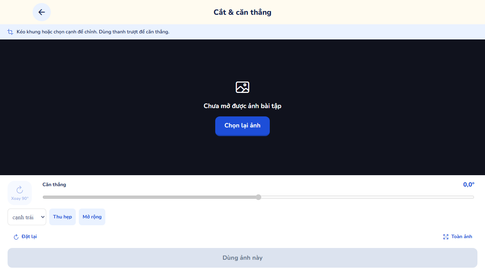
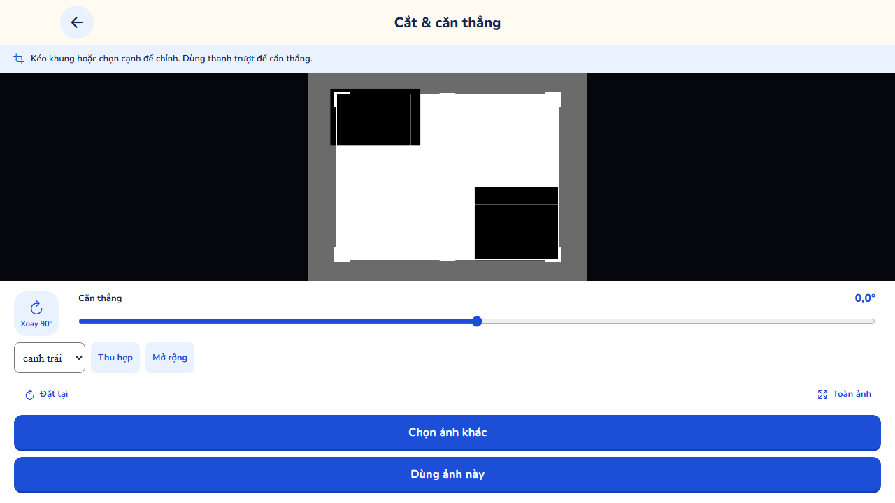

# Student Web: khôi phục ảnh đang chỉnh sửa

Sau khi xác nhận riêng tư, tải lại màn crop khôi phục ảnh đã xác nhận, vùng cắt tương đối, số lần xoay 90 độ và góc căn thẳng. Nút chọn lại mở input file trực tiếp trong thao tác bấm; hủy chọn hoặc giải mã thất bại giữ ảnh hiện tại. Ảnh mới luôn qua bước kiểm tra riêng tư.

## Dữ liệu và quyền riêng tư

- `imageDraftPersistence.web.ts` dùng IndexedDB `mathvision-private-photo-v1`, version 1. Store `drafts` chứa metadata; `images` chứa Blob ảnh đã xác nhận và ảnh crop nếu có. Không lưu chuỗi URL tạm để thay cho dữ liệu ảnh.
- Trước khi xác nhận, trình chỉnh riêng tư trên Student Web giữ tối đa một Blob ảnh nguồn theo phiên đã xác minh trong 30 giây. Tab giữ định danh ảnh, chế độ chụp và các vùng che tương đối trong sessionStorage. Chỉ màn Privacy có thể phục hồi ảnh nguồn nếu phiên và định danh khớp. F5 luôn yêu cầu xác nhận riêng tư lại. Khi ảnh hết hạn, tải lại màn Privacy đưa học sinh về Camera cùng chế độ. Editor đã mở vẫn giữ ảnh trong bộ nhớ để học sinh hoàn tất thao tác.
- Khi xác nhận, vùng che được raster hóa vào pixel. Bản đã duyệt thay bản gốc trong cùng giao dịch. Luồng crop, gửi bài và đọc ảnh chỉ tiếp tục với ảnh đã xác nhận. Khi khôi phục bản đã duyệt, các alias nguồn ảnh đều trỏ đến bản đã xác nhận.
- AuthProvider xác minh tài khoản từ backend trước khi đọc scope theo tài khoản, phiên đăng nhập và mã tab. Profile cache không có thẩm quyền cấp quyền. Kiểm tra version, owner, session, source/revision, hạn, Blob và khả năng giải mã trước khi dùng.
- Đổi phiên vô hiệu hóa tác vụ cũ. Kết quả giải mã thất bại đến muộn phải kiểm tra lại generation trước khi dọn dữ liệu; không được dùng scope của phiên mới để xóa ảnh của tác vụ cũ.
- Native dùng implementation riêng không truy cập IndexedDB/window. Không thêm endpoint, cấu hình, dependency, migration hoặc upload để phục vụ refresh.

## Lưu, phục hồi và dọn dẹp

Với ảnh đã duyệt, thời hạn là 30 phút từ lần chỉnh sửa được lưu, giới hạn tối đa 24 giờ từ lúc tạo; giữ tối đa 3 scope. Xóa khi logout, thay ảnh, hoàn thành đọc/xử lý hoặc phát hiện hỏng/hết hạn. Dọn draft cũ khi mở/khôi phục/lưu tiếp; không có tiến trình chạy khi browser đã đóng. Khôi phục tab cần browser khôi phục cùng sessionStorage; phiên đăng nhập mới không đọc draft phiên cũ.

Blob ảnh nguồn được ghi khi chọn hoặc chụp xong. Tab đang chạy dọn bản lưu khi tới hạn 30 giây. Nếu tab đã đóng hoặc browser tạm ngưng, hạn vẫn được kiểm tra và dữ liệu hết hạn được dọn ở lần truy cập kế tiếp. Logout, thay ảnh và xác nhận xóa hoặc thay thế bản lưu nguồn. Kéo vùng che chỉ ghi metadata, ảnh được ghi lại khi xác nhận. Crop cập nhật metadata khi kết thúc thao tác; journal đồng bộ nhỏ chỉ chứa scope/source/revision, crop và hạn. Journal khác revision bị bỏ qua. Lưu thành công chỉ được công bố sau `transaction.oncomplete`; lỗi/quota/blocked storage có thông báo và đường chọn lại, không loading vô hạn.

Khôi phục tạo URL mới từ Blob. Thu hồi URL do controller/export quản lý khi draft không còn dùng hoặc kết quả bị bỏ; URL kiểm tra giải mã luôn được thu hồi. Ảnh được đọc tại thiết bị, còn xác minh đăng nhập vẫn cần backend.

Processing lưu mốc gửi và submission ID. Khi có ID, refresh tiếp tục GET kết quả. Nếu chưa nhận ID, không tự POST lại; học sinh chủ động xem lại ảnh/gửi tiếp. Tutor bị gián đoạn cũng cần chọn tiếp tục đọc ảnh.

## Kiểm chứng

`tests/student-browser/image-draft-recovery.spec.mjs` chạy ứng dụng export thực, `page.reload()` và IndexedDB thực: hai vùng che/pixel thật, crop/xoay/căn thẳng, preview, hủy/cùng file/giải mã lỗi, hết hạn/hỏng/quota, auth chậm, khác tài khoản/logout, EXIF JPEG, JPG/JPEG/PNG/WebP và ảnh lớn. Kiểm tra bytes ảnh upload sau reload, không POST lặp, tiếp GET submission và Work Review.

`image-draft-session-race.spec.mjs` là contract test controller trong Chromium với IndexedDB thật; điều khiển thời điểm giải mã và ranh giới auth/store để tái hiện đổi phiên. Nó không thay thế kiểm tra giao diện hoặc backend RBAC end-to-end.

```powershell
npm run typecheck --workspace=student-mobile
npm run lint --workspace=student-mobile
npm run test:contracts --workspace=student-mobile
npm test --workspace=student-mobile -- --runInBand
npx playwright test --config=playwright.student.config.mjs
npm run check:governance
git diff --check
```

HTTP backend trong browser suite là fixture, ảnh là tổng hợp. Không coi kết quả này là chứng cứ OCR cloud, Safari/HEIC thật hoặc Expo Go trên thiết bị vật lý. Không đổi timeout/assertion để làm xanh.

## Nguồn và tích hợp

Owner đã nghiệm thu local và cho phép commit/push, mở PR vào develop. Commit local nguồn `a02314c318cbd57bbce2b15dd0634cc62ddc220a` được chọn bằng `cherry-pick -x` trên develop `a48397ef5d6de95a4179c91c2188d492827c0439`, giữ tác giả. Patch ID trước/sau là `b4141ee1c8fb7756eed0f1f9a56dd7dae836359b`. Bản hướng dẫn phần thiếu ở PR #90 vẫn độc lập, không được đưa kèm vào PR sửa ảnh. Xem PR để biết revision cuối và CI; tích hợp source không đồng nghĩa merge hoặc deploy.

## Ảnh minh chứng

Ảnh tổng hợp từ lượt nghiệm thu local của commit nguồn nêu trên; màn crop dùng cùng thay đổi đã chọn sang develop. Không chứa ảnh bài làm thật hoặc tài khoản học sinh.




