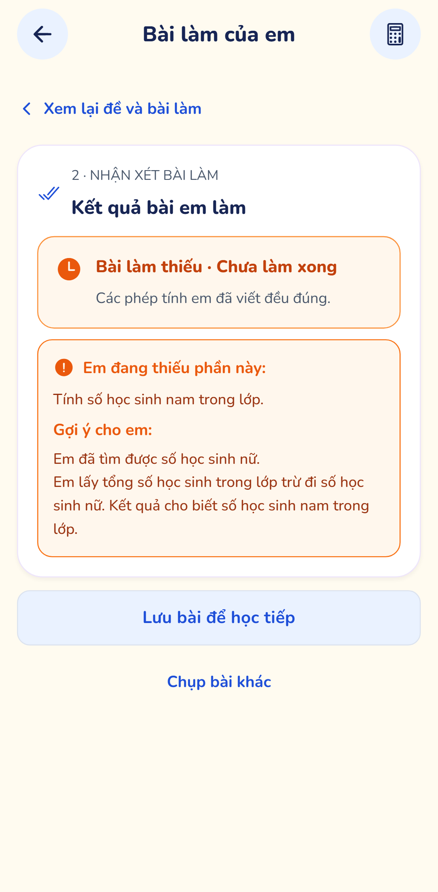
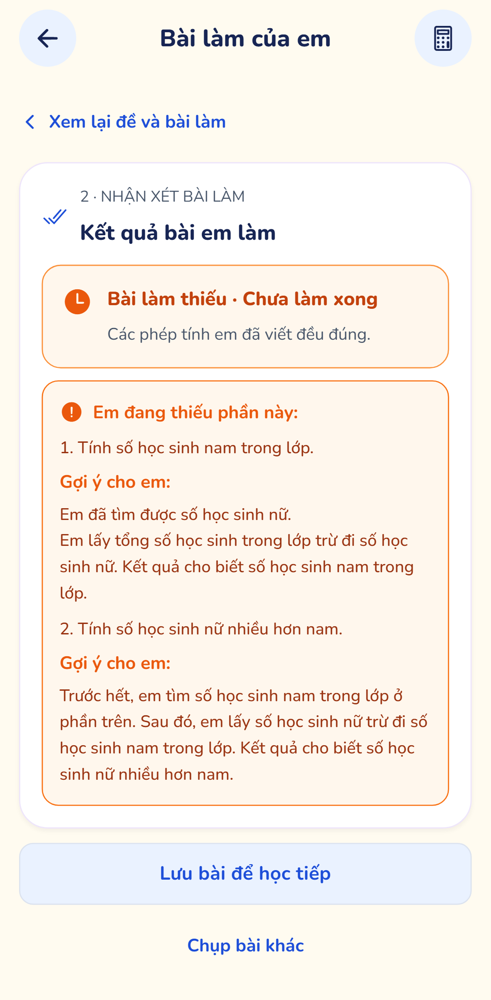

# Hướng dẫn phần bài làm còn thiếu

Work Review giữ riêng kết quả số học, việc dùng đúng dữ kiện/đơn vị và mức độ trả lời đủ câu hỏi. Một phép tính đúng trong bài chưa hoàn thành vẫn là phép tính đúng; lỗi provider không phải bằng chứng bài làm sai hoặc đúng hoàn toàn.

## Phân tích và gợi ý

Từ đề và bài làm đã xác nhận, runtime tách yêu cầu, kiểm tra số học chính xác rồi cho hai reviewer độc lập đánh giá phần chưa hoàn thành. Bằng chứng nội bộ `gaps` ghi yêu cầu, loại phần thiếu, tên đại lượng, các dòng đúng liên quan và dữ kiện nguồn. Một bước cộng/trừ/nhân/chia chỉ được hướng dẫn khi cả hai lượt xác nhận cùng phép toán và đúng thứ tự đầu vào.

Tên đầu vào phải có căn cứ trong dữ kiện, dòng tính đã xác minh hoặc phần thiếu trước đó. Không coi giá trị cần tính từ một quan hệ tỉ lệ là giá trị đề đã cho. Giữ phân biệt phân số, số lượng, tổng và phần còn lại. Khi bước sau phụ thuộc phần chưa làm, gợi ý nhắc làm phần đó trước. Chỉ hướng dẫn bước kế tiếp, không đưa kết quả số hoặc toàn bộ lời giải.

Nếu không đủ bằng chứng cho phép toán, giữ phần thiếu đã xác minh và gợi ý an toàn; không đoán cách giải. Nếu chưa xác minh được chính phần thiếu, Student giữ bài làm và cho thử lại trên nội dung đã xác nhận. Không ép chụp lại ảnh hoặc sửa tiêu đề trung tính.

## Hợp đồng tương thích

Endpoint và request hiện có không đổi. Response bổ sung:

| Trường | Ý nghĩa và giới hạn |
| --- | --- |
| `completionVersion` | `2` cho chính sách bằng chứng mới; có thể vắng trong phản hồi cũ |
| `missingParts` | Danh sách tối đa 8 phần; chỉ có nội dung khi `complete=false` |
| `missingParts[].type` | `MISSING_CALCULATION`, `MISSING_INTERMEDIATE`, `MISSING_ANSWER`, `NOT_STARTED` |
| `target` | Tên đại lượng có căn cứ trong nguồn; tối đa 160 ký tự |
| `description` | Phần em cần bổ sung; tối đa 240 ký tự |
| `hint` | Gợi ý tiếng Việt, không tiết lộ giá trị đáp án; tối đa 300 ký tự |
| `requirementIndex` | Chỉ số yêu cầu, từ 0 đến 7 |
| `relatedLineIndices` | Chỉ trỏ đến dòng `OK` với `arithmeticCorrect=true` trong đúng nguồn hiện tại |
| `evidence` | `DUAL_REVIEW` hoặc `DETERMINISTIC` |

`complete`, `missingPart` và `nextAction` vẫn được giữ để tương thích. Spring và client kiểm tra kiểu, enum, giới hạn và tham chiếu dòng trước khi công bố. Không hiển thị khung thiếu chung chung khi response phiên bản mới chưa có phần thiếu được xác minh. Thiếu đơn vị vẫn thuộc lỗi dòng `UNIT`. Chỉ yêu cầu nhãn đáp số khi đề yêu cầu rõ; không ép một cách giải mẫu.

Lưu bài hiện lưu nguồn bằng chữ, không lưu ảnh riêng tư hoặc snapshot Work Review. Mở lại/sửa bài phải nhận xét lại nguồn và dùng sourceId mới. Abort/sequence và kiểm tra sourceId ngăn phản hồi cũ ghi đè nguồn hiện hành. Luồng Quiz từ Work Review tiếp tục dùng bộ chuẩn bị nguồn đã kiểm chứng hiện có.

## Kiểm thử và hình minh họa

`ai/runtime/tests/test_work_review.py` có 40 đề mới thuộc 8 họ toán và các ca về nhiều câu hỏi, bước trung gian, cách giải gộp, đáp số/đơn vị, safety, bất đồng, quota/timeout và phụ thuộc. Reviewer trong các ca này được mô phỏng; không suy ra độ chính xác cloud từ số lượng unit test.

`tests/student-browser/work-completion.spec.mjs` chạy production Student bundle, storage/navigation thật và HTTP fixture trên viewport desktop/mobile. Nó kiểm tra phần thiếu cụ thể, gợi ý, lưu/mở lại, sửa nguồn và retry. Các ảnh dưới đây là dữ liệu tổng hợp trên Student Web, không phải thiết bị vật lý hoặc bằng chứng AI/backend end-to-end.

## Giới hạn và rollout

Phân tích ngữ nghĩa phụ thuộc chất lượng nguồn đã xác nhận và reviewer. Không mặc định trường xác minh bị thiếu thành đúng, không bỏ safety hoặc xác minh đơn vị để làm xanh giao diện. Trường hợp ngoài giới hạn 8 yêu cầu/35 dòng hoặc chưa đủ căn cứ cần được giữ bài và retry.

Cập nhật runtime, Spring và Student cùng đợt để nhận đủ trường mới. Không có migration hay dependency mới. Rollback bằng revert PR và khôi phục đồng bộ các thành phần qua quy trình phát hành, không sửa dữ liệu học sinh.
