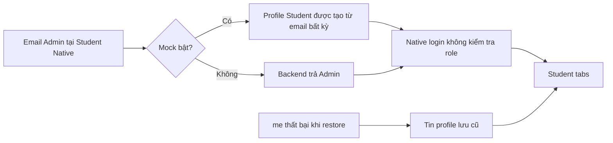
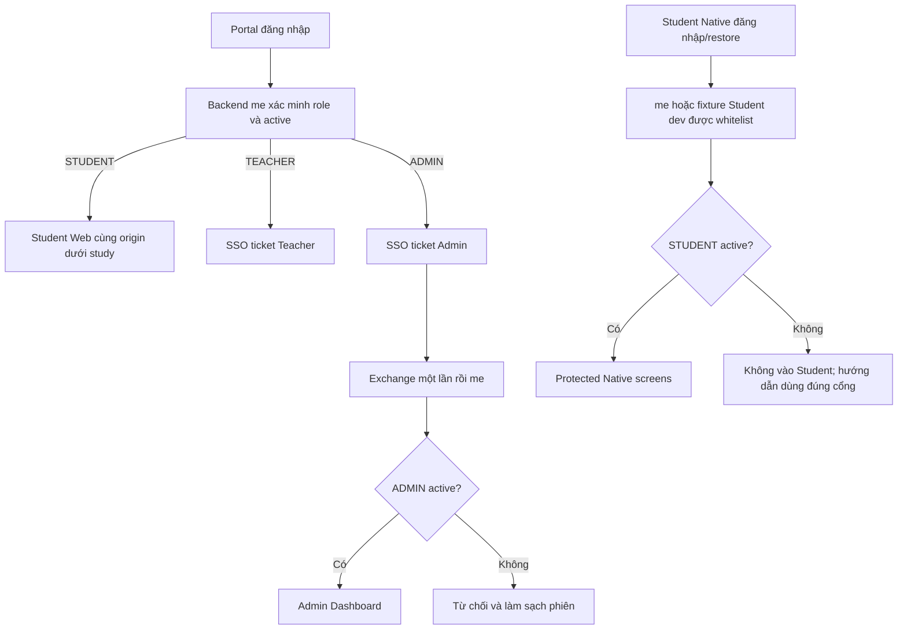

# Admin Portal Overhaul — MathVisionKid

Ngày kiểm chứng: 25/10/2026. Branch ban đầu: `Kha`. Git status ban đầu sạch. Không commit, push, merge, deploy hoặc thay đổi seed password. Database local đang chạy được giữ nguyên; các mutation nghiệm thu dùng Spring Boot và H2 memory riêng.

## Skills Applied

- `ui-ux-pro-max`
  - SKILL.md: `.agents/skills/ui-ux-pro-max/SKILL.md`
  - Why selected: thiết kế lại dashboard quản trị.
  - Applied to: Admin Shell, màu lavender, typography, bố cục responsive, bảng và trạng thái.
- `vercel-react-best-practices`
  - SKILL.md: `.agents/skills/react-best-practices/SKILL.md`
  - Why selected: triển khai React và quản lý dữ liệu bất đồng bộ.
  - Applied to: TanStack Query, invalidation, vòng đời request, loại dữ liệu/phiên cũ.
- `fixing-accessibility`
  - SKILL.md: `.agents/skills/fixing-accessibility/SKILL.md`
  - Why selected: form, dialog, sidebar, bàn phím và trạng thái lỗi.
  - Applied to: nhãn, focus, semantic links, drawer/dialog MUI, trạng thái tải và thông báo.

## 1. Root cause và bằng chứng

Không có bằng chứng backend seed nhầm role Admin thành Student. Lệnh:

```powershell
node scripts/test/admin-overhaul-reproduce.mjs --live-read
```

đã xác minh hai kết quả độc lập, không in password/JWT/refresh token:

- Chạy auth source nguyên bản từ Git HEAD, bật mock và dùng email demo Admin: nhận `STUDENT`, số lần gọi backend bằng 0.
- Gọi backend local thật tại `/api/v1/me` sau đăng nhập demo: role `ADMIN`, active `true`.

Đây là source replay và kiểm tra HTTP local; không phải bằng chứng về trình duyệt/thiết bị mà người dùng đã mở trước khi giao việc.

### Các đường lỗi đã xác nhận

1. `apps/student-mobile/.env` tại thời điểm audit có `EXPO_PUBLIC_USE_MOCK=true`.
2. `apps/student-mobile/src/services/api/authApi.ts`, `getMockStudentUser` và `authApi.login`: mock chấp nhận email ngoài whitelist và tự tạo profile Student. Mật khẩu mock cũ cũng có điều kiện chấp nhận quá rộng.
3. `apps/student-mobile/src/context/AuthContext.tsx`, `login`: đặt authenticated và chuyển `/(tabs)` mà không kiểm tra Student/active; khi lấy profile lỗi còn tạo mock Student.
4. Cùng file, khôi phục phiên: lỗi `/me` vẫn tin profile lưu trước đó. Một profile cũ không thể chứng minh quyền truy cập hiện tại.
5. Native root và tabs trước sửa chưa bảo vệ toàn bộ screen theo role; chỉ sửa nút đăng nhập sẽ không chặn deep link.
6. `apps/admin-web/src/services/api/authService.ts`: có nhánh backend offline tự cấp mock Admin. `adminService.ts` còn trả users/classes/audit và KPI mẫu khi lỗi mạng. Đây là lỗi riêng về tính trung thực và nguồn phân quyền, không phải bằng chứng Portal luôn điều hướng sai.
7. `JwtAuthenticationFilter.doFilterInternal`: nạp UserDetails từ database nhưng chưa kiểm tra enabled trước khi tạo Authentication. Tài khoản bị khóa có thể tiếp tục dùng access token cũ.
8. Các request khôi phục/refresh/logout cần phân biệt phiên đăng nhập mới với việc xoay token trong cùng phiên. Callback cũ có thể ghi đè token, xóa phiên mới hoặc làm lộ dữ liệu cũ nếu chỉ dựa vào profile/token đã lưu.

### Cấu hình/entry point đã kiểm tra

- Portal `LoginPage`, `AdminEntryPage`, `StudentLandingPage`, auth service và API client.
- Admin App, ProtectedRoute, AuthContext, LoginPage, auth/admin services, token store.
- Student Native/Web AuthContext, tokenStorage Native/Web, authApi, API resolver và root/tabs layouts.
- Business API AuthController, JWT filter, RefreshTokenService, SSO service, SecurityConfig, AdminController/AdminService/DTO, OpenAPI.
- Vite, example environments, launcher/deployment scripts và rewrite `/study`.
- Portal mặc định: 5172; Teacher: 5173; Admin: 5174; Business API: 8080. Production yêu cầu HTTPS và origin hợp lệ; không sửa URL production thành localhost.
- README/AGENTS nhắc Expo 57; package baseline thực tế đã là Expo 58/React Native 0.88. Đã đọc tài liệu versioned theo AGENTS, không đổi SDK, lockfile, model AI hoặc dependency ứng dụng.

## 2. Kiến trúc role/session trước và sau

### Trước



Portal vốn có nhánh Admin → SSO → Admin; các đường Native/mock/restore nói trên mới tạo ra lối vào Student không đúng role. Không quy kết một session/trình duyệt cũ cụ thể khi chưa quan sát được.

### Sau



- Backend luôn là nguồn quyền chính thức cho real mode.
- Admin không có mock authority hoặc dữ liệu fallback.
- Student mock chỉ bật rõ ràng trong development, chỉ whitelist Student; không dùng mock token gọi API thật.
- Phiên real không dùng cached profile làm quyền khi offline.
- Native `Stack.Protected` và tabs guard yêu cầu Student active.
- Session identity nội bộ giữ ổn định qua refresh; hàng đợi gộp refresh đồng thời; phản hồi từ tài khoản trước bị loại.
- SecureStore được tuần tự hóa để write refresh cũ không ghi đè account mới sau clear.
- Khi đổi phiên/logout/401, Admin query cache được hủy và làm sạch; detail pages được remount theo ID.
- SSO code đặt trong fragment và scrub trước exchange; backend giữ TTL 60 giây, atomic remove chống replay và kiểm tra lại role/active khi exchange.
- JWT filter kiểm tra trạng thái tài khoản ở mỗi request; không nới RBAC Student/Teacher/Admin. Với 403 ở API quản trị/học sinh, frontend xác minh lại `/me`: role sai hoặc không xác minh được thì xóa phiên; 403 của một tài nguyên vẫn giữ phiên nếu backend xác nhận role phù hợp.

## 3. Chức năng Admin

| Khu vực | Triển khai |
| --- | --- |
| Shell | Sidebar desktop cố định/thu gọn, drawer tablet/mobile, active link, breadcrumb, account và logout, skip link/focus |
| Dashboard | KPI thật từ dashboard API, active/disabled, quick action mở form thật, audit mới nhất, skeleton/error/retry/thời điểm cập nhật |
| Users | API pagination, tìm tên/email, lọc role/trạng thái, tạo Student/Teacher, mở detail |
| User detail | Hồ sơ/lớp liên quan, sửa name/grade hợp lệ, khóa/mở, chặn tự khóa, xác nhận và lỗi mutation |
| Password reset | Backend sinh mật khẩu; kiểm tra response đúng user/email; chỉ state của dialog, không query cache/log/URL; tự xóa sau 60 giây hoặc đóng/unmount |
| Classes | Danh sách và pagination API, tạo/sửa tên/khối/năm học, chọn giáo viên active |
| Class detail | Phân công giáo viên, tìm/pagination người dùng để chọn, thêm/xóa Student active, xác nhận xóa, xem/tìm/phân trang roster thật |
| Audit | Lọc event type và phân trang API; dialog metadata dễ đọc, che trường nhạy cảm |
| Recognition | Empty state trung thực vì chưa có Admin aggregate analytics API; không hiển thị accuracy giả |
| Lỗi | 403, 404, phiên hết hạn, mạng/HTTP errors và nút khôi phục phù hợp |

Không thêm chức năng chấm bài/ghi đè điểm Teacher vào Admin. Không tạo endpoint quản trị giả. Bộ chọn giáo viên/học sinh có tìm kiếm và phân trang, không cắt ngầm danh sách ở 50/100 người.

### Giới hạn API được giữ rõ

- API list lớp hiện chỉ có page/size, không hỗ trợ search/grade/year filter. UI không gửi các filter vô tác dụng.
- Audit API hiện hỗ trợ eventType/page/size; không giả bộ hỗ trợ actor filter.
- Chưa có analytics nhận diện tổng hợp cho Admin.
- Chưa có chính sách bắt buộc đổi mật khẩu ở lần đăng nhập kế tiếp. UI không khẳng định có.
- Không có xóa user/class trong contract hiện tại; không thêm nút xóa giả.

## 4. File đã thay đổi và mục đích

Baseline sạch trên branch `Kha`; không ghi đè WIP. Danh sách dưới đây gồm file tracked thay đổi và file mới, không gồm artifact build/cache ignored. Ảnh/JSON browser được liệt kê ở mục 8.

| File | Mục đích |
| --- | --- |
| `apps/admin-web/package.json` | Thêm suite regression vào script test:config; không thay dependency |
| `apps/admin-web/src/App.tsx` | Admin shell, responsive navigation, token giao diện hoặc route quản trị |
| `apps/admin-web/src/components/classes/ClassFormDialog.tsx` | Form/dialog/table tái sử dụng, validation, mutation lock và trạng thái thao tác |
| `apps/admin-web/src/components/classes/UserPicker.tsx` | Form/dialog/table tái sử dụng, validation, mutation lock và trạng thái thao tác |
| `apps/admin-web/src/components/common/AuditEventChip.tsx` | Form/dialog/table tái sử dụng, validation, mutation lock và trạng thái thao tác |
| `apps/admin-web/src/components/common/AuditMetadata.tsx` | Form/dialog/table tái sử dụng, validation, mutation lock và trạng thái thao tác |
| `apps/admin-web/src/components/common/ConfirmDialog.tsx` | Form/dialog/table tái sử dụng, validation, mutation lock và trạng thái thao tác |
| `apps/admin-web/src/components/common/PageContent.tsx` | Form/dialog/table tái sử dụng, validation, mutation lock và trạng thái thao tác |
| `apps/admin-web/src/components/common/ProtectedRoute.tsx` | Form/dialog/table tái sử dụng, validation, mutation lock và trạng thái thao tác |
| `apps/admin-web/src/components/common/RequestError.tsx` | Form/dialog/table tái sử dụng, validation, mutation lock và trạng thái thao tác |
| `apps/admin-web/src/components/layout/AdminLayout.tsx` | Admin shell, responsive navigation, token giao diện hoặc route quản trị |
| `apps/admin-web/src/components/layout/AdminSidebar.tsx` | Admin shell, responsive navigation, token giao diện hoặc route quản trị |
| `apps/admin-web/src/components/layout/AdminTopbar.tsx` | Admin shell, responsive navigation, token giao diện hoặc route quản trị |
| `apps/admin-web/src/components/layout/NavigationContext.ts` | Admin shell, responsive navigation, token giao diện hoặc route quản trị |
| `apps/admin-web/src/components/users/PasswordResetDialog.tsx` | Form/dialog/table tái sử dụng, validation, mutation lock và trạng thái thao tác |
| `apps/admin-web/src/components/users/UserFormDialog.tsx` | Form/dialog/table tái sử dụng, validation, mutation lock và trạng thái thao tác |
| `apps/admin-web/src/config/runtime.ts` | Mock development opt-in, API resolver và validation cấu hình |
| `apps/admin-web/src/context/AuthContext.tsx` | Backend-authoritative role/session, cô lập account, refresh/logout/SSO/cache |
| `apps/admin-web/src/hooks/useAdminAction.ts` | Form/dialog/table tái sử dụng, validation, mutation lock và trạng thái thao tác |
| `apps/admin-web/src/index.css` | Admin shell, responsive navigation, token giao diện hoặc route quản trị |
| `apps/admin-web/src/main.tsx` | Backend-authoritative role/session, cô lập account, refresh/logout/SSO/cache |
| `apps/admin-web/src/pages/AuditPage.tsx` | Trang quản trị nối API thật, loading/error/empty và thao tác theo contract |
| `apps/admin-web/src/pages/ClassDetailPage.tsx` | Trang quản trị nối API thật, loading/error/empty và thao tác theo contract |
| `apps/admin-web/src/pages/ClassesPage.tsx` | Trang quản trị nối API thật, loading/error/empty và thao tác theo contract |
| `apps/admin-web/src/pages/DashboardPage.tsx` | Trang quản trị nối API thật, loading/error/empty và thao tác theo contract |
| `apps/admin-web/src/pages/LoginPage.tsx` | Trang quản trị nối API thật, loading/error/empty và thao tác theo contract |
| `apps/admin-web/src/pages/RecognitionAnalyticsPage.tsx` | Trang quản trị nối API thật, loading/error/empty và thao tác theo contract |
| `apps/admin-web/src/pages/StatusPage.tsx` | Trang quản trị nối API thật, loading/error/empty và thao tác theo contract |
| `apps/admin-web/src/pages/UserDetailPage.tsx` | Trang quản trị nối API thật, loading/error/empty và thao tác theo contract |
| `apps/admin-web/src/pages/UsersPage.tsx` | Trang quản trị nối API thật, loading/error/empty và thao tác theo contract |
| `apps/admin-web/src/services/api/adminService.ts` | API quản trị hiện có; bỏ fallback dữ liệu mẫu và filter không hỗ trợ |
| `apps/admin-web/src/services/api/apiClient.ts` | Backend-authoritative role/session, cô lập account, refresh/logout/SSO/cache |
| `apps/admin-web/src/services/api/authService.ts` | Backend-authoritative role/session, cô lập account, refresh/logout/SSO/cache |
| `apps/admin-web/src/services/api/tokenStore.ts` | Backend-authoritative role/session, cô lập account, refresh/logout/SSO/cache |
| `apps/admin-web/src/theme.ts` | Admin shell, responsive navigation, token giao diện hoặc route quản trị |
| `apps/admin-web/tests/auth-isolation.test.mjs` | Regression quyền/session/refresh hoặc fixture renderer tương thích guard mới |
| `apps/admin-web/tests/environment.test.mjs` | Regression quyền/session/refresh hoặc fixture renderer tương thích guard mới |
| `apps/admin-web/tests/session-refresh.test.mjs` | Regression quyền/session/refresh hoặc fixture renderer tương thích guard mới |
| `apps/admin-web/tests/sso-flow.test.mjs` | Regression quyền/session/refresh hoặc fixture renderer tương thích guard mới |
| `apps/admin-web/vite.config.ts` | Mock development opt-in, API resolver và validation cấu hình |
| `apps/portal-web/package.json` | Thêm suite regression vào script test:config; không thay dependency |
| `apps/portal-web/src/pages/AdminEntryPage.tsx` | Backend-authoritative role/session, cô lập account, refresh/logout/SSO/cache |
| `apps/portal-web/src/pages/LoginPage.tsx` | Backend-authoritative role/session, cô lập account, refresh/logout/SSO/cache |
| `apps/portal-web/src/pages/LogoutPage.tsx` | Backend-authoritative role/session, cô lập account, refresh/logout/SSO/cache |
| `apps/portal-web/src/services/apiClient.ts` | Backend-authoritative role/session, cô lập account, refresh/logout/SSO/cache |
| `apps/portal-web/src/services/authService.ts` | Backend-authoritative role/session, cô lập account, refresh/logout/SSO/cache |
| `apps/portal-web/tests/auth-profile.test.mjs` | Regression quyền/session/refresh hoặc fixture renderer tương thích guard mới |
| `apps/portal-web/tests/auth-session-isolation.test.mjs` | Regression quyền/session/refresh hoặc fixture renderer tương thích guard mới |
| `apps/student-mobile/src/__tests__/mockAuthIsolation.test.ts` | Regression quyền/session/refresh hoặc fixture renderer tương thích guard mới |
| `apps/student-mobile/src/__tests__/nativeLoginPlatformNotice.test.tsx` | Regression quyền/session/refresh hoặc fixture renderer tương thích guard mới |
| `apps/student-mobile/src/__tests__/startupArt.test.tsx` | Regression quyền/session/refresh hoặc fixture renderer tương thích guard mới |
| `apps/student-mobile/src/__tests__/tutorScreen.test.tsx` | Regression quyền/session/refresh hoặc fixture renderer tương thích guard mới |
| `apps/student-mobile/src/app/(tabs)/_layout.tsx` | Chặn mọi màn hình học tập theo Student active; hướng dẫn sai nền tảng |
| `apps/student-mobile/src/app/_layout.tsx` | Chặn mọi màn hình học tập theo Student active; hướng dẫn sai nền tảng |
| `apps/student-mobile/src/app/login.tsx` | Chặn mọi màn hình học tập theo Student active; hướng dẫn sai nền tảng |
| `apps/student-mobile/src/config/apiResolver.ts` | Mock development opt-in, API resolver và validation cấu hình |
| `apps/student-mobile/src/config/env.ts` | Mock development opt-in, API resolver và validation cấu hình |
| `apps/student-mobile/src/context/AuthContext.tsx` | Backend-authoritative role/session, cô lập account, refresh/logout/SSO/cache |
| `apps/student-mobile/src/context/AuthContext.web.tsx` | Backend-authoritative role/session, cô lập account, refresh/logout/SSO/cache |
| `apps/student-mobile/src/context/__tests__/nativeAdminIsolation.test.tsx` | Regression quyền/session/refresh hoặc fixture renderer tương thích guard mới |
| `apps/student-mobile/src/context/__tests__/webAuthSession.test.mjs` | Regression quyền/session/refresh hoặc fixture renderer tương thích guard mới |
| `apps/student-mobile/src/services/api/apiClient.ts` | Backend-authoritative role/session, cô lập account, refresh/logout/SSO/cache |
| `apps/student-mobile/src/services/api/authApi.ts` | Backend-authoritative role/session, cô lập account, refresh/logout/SSO/cache |
| `apps/student-mobile/src/services/auth/__tests__/tokenStorageIsolation.test.ts` | Regression quyền/session/refresh hoặc fixture renderer tương thích guard mới |
| `apps/student-mobile/src/services/auth/sessionEvents.ts` | Backend-authoritative role/session, cô lập account, refresh/logout/SSO/cache |
| `apps/student-mobile/src/services/auth/studentAccess.ts` | Backend-authoritative role/session, cô lập account, refresh/logout/SSO/cache |
| `apps/student-mobile/src/services/auth/tokenStorage.ts` | Backend-authoritative role/session, cô lập account, refresh/logout/SSO/cache |
| `apps/student-mobile/src/services/auth/tokenStorage.web.ts` | Backend-authoritative role/session, cô lập account, refresh/logout/SSO/cache |
| `backend/business-api/src/main/java/com/mathvisionkids/api/auth/AuthController.java` | Backend xác minh email chuẩn hóa, account active và role SSO hiện tại |
| `backend/business-api/src/main/java/com/mathvisionkids/api/auth/JwtAuthenticationFilter.java` | Backend xác minh email chuẩn hóa, account active và role SSO hiện tại |
| `backend/business-api/src/main/java/com/mathvisionkids/api/auth/RefreshTokenService.java` | Backend xác minh email chuẩn hóa, account active và role SSO hiện tại |
| `backend/business-api/src/main/java/com/mathvisionkids/api/auth/sso/SsoHandoffService.java` | Backend xác minh email chuẩn hóa, account active và role SSO hiện tại |
| `backend/business-api/src/test/java/com/mathvisionkids/api/auth/AdminRoleIsolationTest.java` | Regression role/JWT/SSO hoặc launcher test H2 ngoài production component scan |
| `backend/business-api/src/test/java/com/mathvisionkids/api/auth/sso/SsoHandoffServiceTest.java` | Regression role/JWT/SSO hoặc launcher test H2 ngoài production component scan |
| `backend/business-api/src/test/java/com/mathvisionkids/validation/AdminOverhaulPreview.java` | Regression role/JWT/SSO hoặc launcher test H2 ngoài production component scan |
| `report/ADMIN_PORTAL_OVERHAUL.md` | Báo cáo nguyên nhân, thay đổi, kết quả và hướng dẫn kiểm chứng |
| `scripts/deploy/web_bundle_smoke.mjs` | Cập nhật smoke selectors theo semantics skeleton/error/link mới |
| `scripts/test/admin-overhaul-browser.mjs` | Harness tái lập, checks/export hoặc browser CRUD trên H2 biệt lập |
| `scripts/test/admin-overhaul-checks.mjs` | Harness tái lập, checks/export hoặc browser CRUD trên H2 biệt lập |
| `scripts/test/admin-overhaul-export.mjs` | Harness tái lập, checks/export hoặc browser CRUD trên H2 biệt lập |
| `scripts/test/admin-overhaul-reproduce.mjs` | Harness tái lập, checks/export hoặc browser CRUD trên H2 biệt lập |
| `scripts/test/admin-overhaul.init.gradle` | Harness tái lập, checks/export hoặc browser CRUD trên H2 biệt lập |

`apps/student-mobile/.env` local (ignored) chỉ đổi `EXPO_PUBLIC_USE_MOCK` từ true sang false, giữ các giá trị còn lại. Cần giữ cờ này đúng trên máy khác; thay đổi ignored không đi cùng Git diff. Không thay root/package lockfile hoặc phiên bản dependency.

## 5. Kết quả kiểm chứng thực tế

### Kết quả cuối trên mã bàn giao

| Nhóm | Kết quả |
| --- | --- |
| Source replay + local `/me` | HEAD mock nhận Student với email Admin, 0 backend call; real backend trả ADMIN active |
| Admin test:config | 34 pass / 0 fail, gồm auth isolation, single-flight refresh, late A/B responses, role đổi sau 403, SSO StrictMode |
| Admin test:production | 5 pass / 0 fail; đây là bundle/jsdom tests, không gọi là E2E |
| Portal test:config | 19 pass / 0 fail |
| Portal test:production | 2 pass / 0 fail |
| Teacher test:config / test:production | 21/21 và 2/2 pass |
| Admin, Portal, Teacher lint và production build | Exit 0; build gồm `tsc -b` |
| Student typecheck / lint | Exit 0; còn 2 warning có sẵn `no-unused-expressions` ở `cropRotation.web.ts` |
| Student Web session Node suite | 8 pass / 0 fail (gồm một parent test và 7 subtests) |
| Backend full Gradle suite | 371 tests / 33 suites, 0 failure, 0 error, 0 skipped; H2 test profile |
| Student Web static export | Exit 0; 38 routes, 44 bundles, đủ 5 game bundles |
| Edge browser, real HTTP Spring/H2 | 16/16 bước pass, gồm CRUD user/class và phân quyền; 0 pageerror |
| `git diff --check` | Exit 0, không có whitespace error |

Student full Jest summary:

```text
Test Suites: 81 passed, 81 total
Tests:       945 passed, 945 total
Snapshots:   0 total
Time:        286.051 s
```

Các lệnh được wrapper chạy (kết quả thô: `infra/local-runtime/admin-overhaul/*-checks.json`, ignored):

| Lệnh | Kết quả |
| --- | --- |
| `npm run test:config --workspace=admin-web` | Exit 0 |
| `npm run lint --workspace=admin-web` | Exit 0 |
| `npm run build --workspace=admin-web` | Exit 0 |
| `npm run test:production --workspace=admin-web` | Exit 0 |
| `npm run test:config --workspace=portal-web` | Exit 0 |
| `npm run lint --workspace=portal-web` | Exit 0 |
| `npm run build --workspace=portal-web` | Exit 0 |
| `npm run test:production --workspace=portal-web` | Exit 0 |
| `npm run test:config --workspace=teacher-web` | Exit 0 |
| `npm run lint --workspace=teacher-web` | Exit 0 |
| `npm run build --workspace=teacher-web` | Exit 0 |
| `npm run test:production --workspace=teacher-web` | Exit 0 |
| `npm run typecheck --workspace=student-mobile` | Exit 0 |
| `npm run lint --workspace=student-mobile` | Exit 0 |
| `npm test --workspace=student-mobile -- --runInBand --silent --testTimeout=30000` | Exit 0 |

Lệnh bổ sung đã chạy:

```powershell
node scripts/test/admin-overhaul-reproduce.mjs --live-read
node --test apps/student-mobile/src/context/__tests__/webAuthSession.test.mjs
# Trong backend/business-api:
.\gradlew.bat test --no-daemon --console=plain
# Tại repository root:
node scripts/test/admin-overhaul-export.mjs
$env:MVK_PLAYWRIGHT_ROOT='C:/Users/khatr/admin-overhaul-validation'
node scripts/test/admin-overhaul-browser.mjs
git diff --check
```

### Phạm vi regression A–H

| Yêu cầu | Bằng chứng |
| --- | --- |
| A ADMIN Portal → Admin | Edge real SSO/exchange/dashboard + backend `/me` |
| B ADMIN qua Student Web/Native không vào Student | Edge chạy bundle Student Web thật; Native Jest login/restore/root guards và thông báo đúng nền tảng |
| C/D Student/Teacher bị chặn ở Admin | Edge UI và API403; backend AdminRoleIsolationTest |
| E Disabled/expired/wrong-role | Edge disable tài khoản và thử access đã cấp; invalid access/refresh; backend JWT/refresh tests; frontend restore tests |
| F SSO hết hạn/replay/invalid | Backend unit/integration TTL/atomic/recheck role; Edge replay và invalid ticket. Không phải mọi tình huống đều chờ TTL thật trong browser |
| G A/B, reload, logout | Edge navigation/reload/logout; service/context/SecureStore tests cho late request A/B và refresh concurrency |
| H Mock không cấp Admin giả | Test whitelist, production gate, offline backend; Admin auth/data không có mock authority |

Browser dùng frontend thật và Spring Boot/H2 memory thật cho luồng tích cực. Negative network test chủ động abort 2 GET rồi retry tới backend thật. Student export giữ HTTPS validation; browser proxy alias HTTPS kiểm chứng tới backend H2, không trả profile fixture. Network evidence chỉ lưu path/status. Có console resource errors tương ứng lỗi mạng/401 được cố ý kiểm tra; không có JS pageerror hay lỗi console ngoài tình huống kiểm thử dự kiến. Không lưu request body, Authorization, password, token hoặc SSO ticket vào report/ảnh.

### Các lần chưa đạt và cách xử lý

- Student full lượt đầu: 936/938 pass, hai timeout 5 giây ở tutor/gallery. Lượt kế tiếp: 937/940 pass, gồm tutor timeout và hai startup fixtures chưa biết AuthContext/Stack.Protected mới. Gallery đạt khi chạy lại; không sửa gallery business logic.
- Native startup fixture được cập nhật đúng auth context/guard và thêm bốn assertion route isolation. Tutor renderer bị treo ở `act` khi render native illustration: thêm host Image stub cho riêng AppIllustration trong test, giữ toàn bộ assertion bài phân số và hành vi Tutor. Không sửa source nghiệp vụ Tutor, không bỏ test. Full suite cuối được ghi phía trên.
- Fixture auth cũ thiếu active, smoke selector chỉ tìm progressbar, icon/label stubs và harness launcher ban đầu chưa tương thích đã được sửa; suite cuối đạt. Production smoke vẫn kiểm tra loading/error/usable navigation.
- Teacher lint còn warning Fast Refresh `only-export-components` có sẵn. Vite cảnh báo bundle Admin/Portal/Teacher trên 500KB; build vẫn thành công. Không che warning bằng đổi threshold hoặc thêm dependency.

Không coi unit test, fixture hoặc production build là bằng chứng browser E2E. Không có bằng chứng chạy thiết bị Native vật lý hoặc gọi OCR/AI cloud xuyên suốt.

## 6. Chạy local và tự kiểm chứng

### Hệ thống hiện có

```powershell
cd C:\MathVisonKid
.\RUN_EXPO.bat
```

- Portal: http://localhost:5172/login
- Cổng Admin từ Portal: http://localhost:5172/admin
- Admin trực tiếp: http://localhost:5174/login
- Admin alias: http://localhost:5174/admin
- Teacher: http://localhost:5173
- Backend health: http://localhost:8080/actuator/health

Dùng `admin.demo@mathvision.local` được seed trong dev profile; tham khảo cấu hình/seed local để lấy credential. Báo cáo không lặp lại mật khẩu.

Backend 8080 đang chạy trước nhiệm vụ được giữ nguyên; cần rebuild/restart Business API qua launcher để nạp Java fixes. Test harness đã khởi động Spring mới với mã đã sửa. Không dừng stack local của người dùng trong nghiệm thu.

Đặt `VITE_USE_MOCK=false`, `EXPO_PUBLIC_USE_MOCK=false` cho real mode. Native chỉ cho Student vào các screen học tập; Admin/Teacher được hướng dẫn dùng cổng web. Sau khi đổi env, khởi động lại dev server/Metro.

Portal Vite local thông thường không tự phục vụ bản export `/study`. Để kiểm tra Student Web cùng origin cần export và cấu hình static hosting/rewrite theo hướng dẫn deployment hiện có; browser harness tự phục vụ bản export riêng. Native dùng launcher/Metro hiện có.

Production dùng các `VITE_API_BASE_URL`, `VITE_ADMIN_URL`, `VITE_TEACHER_URL`, `VITE_PORTAL_URL` HTTPS đúng origin. Student Web cùng origin dưới `/study` theo export/deployment rewrite hiện có; không đưa JWT vào URL để chuyển origin.

### Bộ kiểm chứng ứng dụng

```powershell
node scripts/test/admin-overhaul-reproduce.mjs --live-read
node scripts/test/admin-overhaul-checks.mjs admin
node scripts/test/admin-overhaul-checks.mjs portal
node scripts/test/admin-overhaul-checks.mjs teacher
node scripts/test/admin-overhaul-checks.mjs student
node --test apps/student-mobile/src/context/__tests__/webAuthSession.test.mjs
cd backend/business-api
.\gradlew.bat test --console=plain
```

Script checks dùng các origin HTTPS `.example` chỉ để build/test artifact, không deploy. Kết quả thô của các npm checks ở `infra/local-runtime/admin-overhaul/*-checks.json` (ignored). Nếu PowerShell chặn npm.ps1, dùng `npm.cmd`; không cần đổi execution policy hệ thống.

### Browser/CRUD cô lập

Cài Playwright trong thư mục kiểm chứng riêng hoặc dùng bản đã có. Không cần thêm dependency vào repository.

```powershell
node scripts/test/admin-overhaul-export.mjs
$env:MVK_PLAYWRIGHT_ROOT='C:/Users/khatr/admin-overhaul-validation'
node scripts/test/admin-overhaul-browser.mjs
```

- Harness dùng H2 memory và loopback 18080; các web test servers ở 15172/15173/15174.
- Tự sinh credential ephemeral trong memory, không đổi seed hay database local.
- Chỉ cho CRUD sau khi response xác nhận header marker H2; từ chối nếu test port đã có service khác.
- Student static export giữ HTTPS validation. Trong browser test, alias HTTPS kiểm chứng được proxy tới Spring/H2 thật, không trả fixture.
- Tự dừng đúng process tree đã tạo; không dừng stack local của người dùng.
- Có thể đặt `MVK_BROWSER_PATH` nếu Edge ở vị trí khác.
- Kết quả: `report/admin-overhaul/browser-results.json`; ảnh responsive cùng thư mục.

## 7. Rủi ro còn lại và hướng phát triển

- Chưa kiểm chứng thiết bị Native vật lý, OCR/AI runtime cloud hoặc chơi toàn bộ game bằng thao tác tay; đã chạy regression Student/Tutor/games, backend và export đủ bundle. Không thay model AI, gameplay hoặc Expo SDK.
- Logout/reset password thu hồi refresh token theo contract hiện có. Access JWT đã cấp có thể còn hiệu lực tới expiry; khóa tài khoản nay bị JWT filter chặn ngay. Cơ chế thu hồi access token tức thì cho logout/reset cần thiết kế riêng.
- Chưa có force-password-change và aggregate recognition metrics; cần contract/policy backend trước khi mở UI. Classes list chỉ hỗ trợ pagination; audit chỉ eventType/page/size.
- SSO ticket store memory phù hợp một instance; nhiều replica cần shared store/sticky routing theo thiết kế triển khai.
- Bundle web lớn hơn ngưỡng cảnh báo Vite; có thể tiếp tục lazy load theo route ở nhiệm vụ hiệu năng riêng.
- Java fixes chưa được nạp vào tiến trình backend local đã chạy từ trước; cần restart theo mục 6. Không mutation database local/production, không đổi seed password, không commit/push/deploy.
- Các artifact kiểm chứng dùng HTTPS `.example` và H2 memory, không được deploy như artifact production.

## 8. Ảnh và bằng chứng browser

Ảnh chụp Edge headless từ UI hoạt động với dữ liệu test lưu thật qua Spring/H2 memory, không phải mock dashboard hoặc dữ liệu production. Dữ liệu bị hủy khi harness dừng. Các ảnh form chỉ chụp form trống, không chụp credential/reset secret.

- [Kết quả 16 luồng + Console/Network đã lọc](admin-overhaul/browser-results.json)
- [Dashboard desktop 1440px](admin-overhaul/dashboard-1440.png)
- [Dashboard 1024px](admin-overhaul/dashboard-1024.png)
- [Dashboard tablet 768px](admin-overhaul/dashboard-768.png)
- [Dashboard mobile 390px](admin-overhaul/dashboard-390.png)
- [Drawer tablet](admin-overhaul/navigation-768.png), [drawer mobile](admin-overhaul/navigation-390.png)
- [Quản lý người dùng](admin-overhaul/users-1440.png)
- [Form tạo tài khoản mobile](admin-overhaul/user-create-390.png)
- [Chi tiết lớp](admin-overhaul/class-detail-1440.png)
- [Audit](admin-overhaul/audit-1440.png)
- [Nhận diện: empty state đúng khả năng API](admin-overhaul/recognition-1440.png)

Browser đã kiểm tra nút/luồng thực, tìm kiếm/lọc/phân trang, drawer/collapse, keyboard skip/navigation, lỗi mạng và retry, và `document.documentElement.scrollWidth <= window.innerWidth + 1` tại 390/768/1024/1440px. Đây chưa phải audit WCAG tự động đầy đủ.

Skills applied: ui-ux-pro-max, vercel-react-best-practices, fixing-accessibility.
