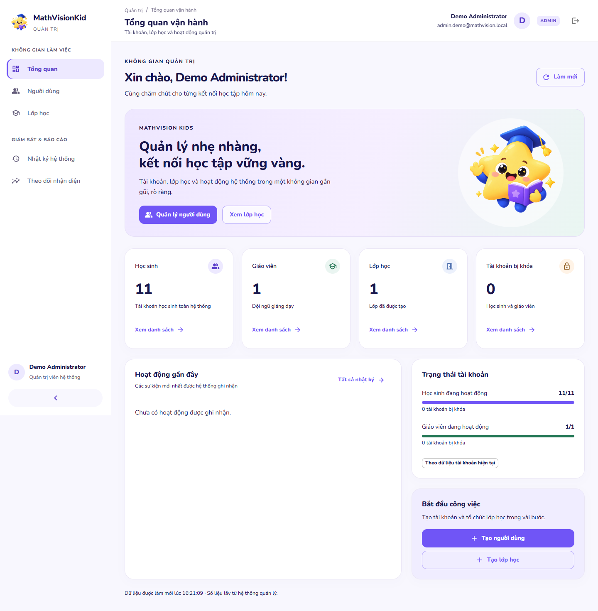

# Admin UI và cấu hình local

Ngày thực hiện: 26/10/2026. Repository: `C:\MathVisonKid`, branch `Kha`.

## Skills Applied

- `ui-ux-pro-max`
  - SKILL.md: `.agents/skills/ui-ux-pro-max/SKILL.md`
  - Why selected: thiết kế dashboard giáo dục sáng, đồng bộ ngôn ngữ Student.
  - Applied to: palette, shell, hero, spacing, cards và responsive.
- `vercel-react-best-practices`
  - SKILL.md: `.agents/skills/react-best-practices/SKILL.md`
  - Why selected: triển khai giao diện React trên MUI hiện có.
  - Applied to: giữ query độc lập/cache, asset tĩnh, tái sử dụng theme và component.
- `fixing-accessibility`
  - SKILL.md: `.agents/skills/fixing-accessibility/SKILL.md`
  - Why selected: điều hướng, focus, drawer, form và modal.
  - Applied to: tương phản, tên accessible, ảnh trang trí, semantic headings và kiểm tra bàn phím.

## Phạm vi và bảo toàn WIP

Git status ban đầu **không sạch**: đã có WIP Admin, Portal, Student và backend auth cùng report/test chưa commit. Các thay đổi đó được giữ lại; không coi toàn bộ diff với HEAD là công việc của lượt này. Đối chiếu byte xác nhận 70 file WIP ngoài phần chủ động sửa giữ nguyên, không có file mất hoặc thay đổi ngoài dự kiến. Bản lưu riêng nằm trong `infra/local-runtime/admin-ui-env-baseline/` được Git ignore, gồm status, các file WIP đã chỉnh và cấu hình trước sửa. Bản lưu chứa cấu hình riêng tư, chỉ giữ local, không đính kèm/chia sẻ.

Không commit/push/deploy, không reset Git, không đổi SDK/model, không training, không recreate DB hoặc xóa volume. Student/Teacher/AI/OCR source và API contract không bị sửa trong lượt này. Student chỉ được cập nhật `.env` cho chạy trên PC. Các mutation nghiệm thu dùng Spring Boot thật với H2 memory riêng, không dùng PostgreSQL đang hoạt động.

Đã đọc AGENTS, README, Admin Lite scope, hướng dẫn local, kiến trúc runtime, prototype HTML, Student theme/components/assets, Admin layout/pages/API/auth, AdminController/DTO/AdminService và OpenAPI. Theo yêu cầu AGENTS đã mở [Expo v57 reference](https://docs.expo.dev/versions/v57.0.0/); không dùng việc này để nâng SDK.

## Giao diện trước và sau

Sidebar trước dùng nền tím rất tối. Sau sửa: sidebar trắng, active lavender, logo Sao nhỏ thật; toàn bộ trang dùng nền `#F8F7FE`, thương hiệu `#7055F6`, Nunito local, card bo 22px và dialog 24px. Topbar có breadcrumb, tên/ảnh chữ cái Admin và đăng xuất thật. Không thêm tìm kiếm/thông báo giả.

Dashboard có lời chào, hero lavender/mint với ảnh `/ui/mathvision-star.png` đã có trong repository; CTA liên kết danh sách người dùng/lớp học. KPI vẫn lấy `/admin/dashboard`; hoạt động lấy `/admin/audit`. Không sao chép dữ liệu prototype. Network error vẫn có cảnh báo và thử lại; không đổi thành số 0. Recognition giữ thông báo chưa có API tổng hợp, không tạo số liệu.

Theme chung áp dụng cho dashboard, users/detail, classes/detail, audit và recognition; giữ nguyên các form, filter, pagination và mutation API thật của WIP.

| Bằng chứng local thật | Trước | Sau |
|---|---|---|
| Dashboard 1440px | [ảnh trước](admin-ui-env/before-dashboard-1440.png) | [ảnh sau](admin-ui-env/after-dashboard-1440.png) |
| Dashboard 390px | [ảnh trước](admin-ui-env/before-dashboard-390.png) | [ảnh sau](admin-ui-env/after-dashboard-390.png) |
| 768px / 1024px | — | [768px](admin-ui-env/after-dashboard-768.png), [1024px](admin-ui-env/after-dashboard-1024.png) |

## File thay đổi trong lượt này

- `apps/admin-web/src/theme.ts`: tokens, card/dialog/input/button styling dùng chung.
- `apps/admin-web/src/index.css`: nền sáng, hero và responsive.
- `apps/admin-web/src/components/layout/AdminSidebar.tsx`: sidebar sáng và mascot repository.
- `apps/admin-web/src/components/layout/AdminTopbar.tsx`: avatar và typography breadcrumb.
- `apps/admin-web/src/pages/DashboardPage.tsx`: lời chào, hero/CTA thật, sắc mint cho trạng thái giáo viên.
- `backend/business-api/.env.example`: sửa mẫu mật khẩu DB local cho khớp Compose; không thay mật khẩu DB.
- `scripts/dev/local-env.ps1`: đọc dotenv nguyên văn, allowlist, không evaluate, không log giá trị.
- `scripts/dev/start-all.ps1`: nạp env riêng khi launch Spring; không in raw stderr có thể chứa cấu hình.
- `scripts/test/local-env.test.ps1`: kiểm tra precedence, child inheritance và cleanup môi trường.
- `scripts/test/admin-ui-env-live.mjs`: đăng nhập Portal, kiểm tra `/me`, screenshot và responsive trên stack local hiện có; chỉ đọc dữ liệu nghiệp vụ.
- `scripts/test/admin-overhaul-browser.mjs`: cho chọn thư mục bằng chứng riêng và cache Vite riêng, tránh đụng cache dev server đang chạy.
- `.env.example` root được phục hồi nguyên bản từ Git; `.env` và file mẫu khác không bị ghi đè bởi thao tác phục hồi.
- `.env` local và bằng chứng dưới `report/admin-ui-env/` như các mục bên dưới.

## Trạng thái từng `.env`

Tất cả bảy file dưới đây tồn tại và được `git check-ignore` xác nhận bỏ qua; không stage file nào. Không có secret trong biến `VITE_*`/`EXPO_PUBLIC_*`.

| Đường dẫn | Biến tự điền / đã giữ và kiểm tra | Chưa điền / cần cung cấp | Nguồn và lý do |
|---|---|---|---|
| `.env` | Giữ nguyên nội dung đang có, gồm cấu hình DB/JWT/internal/MinIO và default local | Không thiếu cho Admin local; key cloud không được tự bịa | So sánh trong máy với `.env.example` phục hồi từ Git. Root dùng chung có `PORT` của AI, vì vậy không export toàn bộ cho mọi service. |
| `backend/business-api/.env` | Tạo từ biến backend đang có tại root; `PORT=8080`, profile dev, URL AI local; giữ DB/JWT/internal/MinIO hiện có | Không thiếu cho local đã kiểm tra | `application-dev.yml`, `application.yml`, Compose và TCP authentication PostgreSQL. Signing/internal defaults khớp cấu hình dev hiện hành. Giá trị secret không ghi trong báo cáo. |
| `apps/admin-web/.env` | `VITE_API_BASE_URL=http://localhost:8080/api/v1`, `VITE_PORTAL_URL=http://localhost:5172`, `VITE_SHOW_DEV_TOOLS=false`, `VITE_USE_MOCK=false` | Không | Yêu cầu owner, Vite và resolver hiện có. |
| `apps/portal-web/.env` | API local; Teacher `http://localhost:5173`, Admin `http://localhost:5174`; mock/dev tools=false | Không | Biến đúng tên theo `.env.example` và environment resolver. |
| `apps/teacher-web/.env` | API local, Portal `http://localhost:5172`; mock/dev tools=false | Không | Biến đúng tên theo `.env.example` và environment resolver. |
| `apps/student-mobile/.env` | `EXPO_PUBLIC_API_BASE_URL=http://localhost:8080/api/v1`, `EXPO_PUBLIC_USE_MOCK=false` | IP LAN nếu chuyển sang điện thoại thật | Cấu hình hiện tại dành cho PC. `localhost` trên điện thoại là chính điện thoại, không phải PC. Owner cần cung cấp IPv4 LAN của PC trên mạng Wi-Fi đang dùng; không đoán IP. |
| `ai/runtime/.env` | Giữ cấu hình OCR có sẵn; development/FIXTURE; Groq/Gemini=false; hai API key để rỗng | Key provider hợp lệ nếu muốn bật cloud; model artifact hợp lệ nếu dùng mode yêu cầu model | `app/config.py`, `.env.example`, Compose và file hiện có. Không bật model thật hoặc sửa OCR/provider/artifact hiện có trong lượt này. |

PostgreSQL đã được thử đăng nhập **qua TCP**, không chỉ `pg_isready`: cả cấu hình mật khẩu hiện tại và default Compose đều thành công. Không sửa password trong database. Chỉ chỉnh mẫu backend đang ghi default lệch Compose; nếu dùng volume khác sau này cần kiểm tra lại, không xóa volume để sửa lỗi.

MinIO giữ giá trị dev khớp Compose; báo cáo không ghi lại password. Không kiểm chứng bằng upload ảnh học sinh. Không phát sinh cloud key, JWT secret hoặc internal key mới.

### Launcher và thứ tự ưu tiên

Spring Boot không tự đọc dotenv. Launcher mới chỉ áp dụng các biến backend được cho phép, theo thứ tự **môi trường tiến trình > backend `.env` > root `.env` > fallback application-dev**. Sau khi tạo tiến trình con, môi trường launcher được khôi phục, kể cả khi có lỗi. Vì vậy không mang `PORT=8000` hay secret root sang Vite/Student. Không chạy lại toàn bộ launcher hoặc restart backend đang có chỉ để kiểm thử.

AI Pydantic đọc service `.env` và `.env.local`; process environment ưu tiên cao hơn. Docker Compose inject riêng development/FIXTURE, Redis và callback Docker; không mặc định lấy root `.env` hoặc service `.env` làm `env_file`. `.env.local` AI chưa tồn tại tại thời điểm kiểm tra. Bật cloud sau này cần cấu hình provider/key thật và restart đúng process/container; fixture không phải bằng chứng OCR thật.

## Kiểm thử

| Lệnh / kiểm tra | Kết quả |
|---|---|
| `npm run lint --workspace=admin-web` | PASS |
| `npx tsc -b apps/admin-web` | PASS |
| `npm run test:config --workspace=admin-web` | PASS, 34 test: ADMIN, STUDENT/TEACHER, inactive, expired/refresh, offline, SSO, cache/session isolation |
| `node scripts/test/admin-overhaul-checks.mjs admin` | PASS: config, lint, build và production bundle |
| Production bundle tests trong runner trên | PASS, 5 test: bundle không chứa URL local/demo auth, SSO, logout, detail loading/error trên mobile |
| `npm run test:config --workspace=portal-web` | PASS, 19 test |
| `powershell -NoProfile -ExecutionPolicy Bypass -File scripts/test/local-env.test.ps1` | PASS: file/service/process precedence, literal/no evaluation, allowlist, child inheritance, restore success/failure, lỗi không lộ giá trị |
| PowerShell AST parse `scripts/dev/start-all.ps1` | PASS |
| Nạp root + backend env với loader và kiểm tra port/JWT bằng predicate | PASS, không in giá trị bí mật |
| `.venv/Scripts/python.exe -m pytest tests/test_settings_env_precedence.py -q` tại `ai/runtime` | PASS, 2 test |
| TCP DB authentication, Git ignore, kiểm tra tên biến public | PASS |
| Live browser trước/sau trên `localhost:5174` | PASS: Portal SSO, `/me.role=ADMIN`, layout Admin, dashboard và users/detail/classes/detail/audit/recognition ở 390/768/1024/1440 không tràn ngang, 0 runtime errors |
| `node scripts/test/admin-overhaul-browser.mjs` với `MVK_PLAYWRIGHT_ROOT` và `MVK_BROWSER_REPORT_DIR=report/admin-ui-env/isolated-browser` | PASS: 16 kịch bản, backend Spring Boot HTTP thật + H2 memory, 0 page/runtime errors |
| `git diff --check` | PASS; Git có cảnh báo chuẩn hóa LF/CRLF, không có lỗi whitespace |

Build dùng URL HTTPS dành riêng cho test từ runner đã có, không phải deploy hoặc hostname dùng cho `.env` local. Build có cảnh báo chunk JavaScript lớn hơn 500kB; chưa mở rộng phạm vi sang tối ưu bundle.

Lượt browser CRUD đầu tiên FAIL sau khi env được ghi khiến Vite restart và dependency cache trả 504, timeout ở bước tạo Teacher. Bốn bước trước đó đã pass. Bằng chứng lượt lỗi giữ tại `admin-ui-env/interrupted-browser/`. Cache/output riêng đã bổ sung cho harness; các lượt chạy trùng cổng bị từ chối, không dừng service đang dùng. Không báo các lượt này thành PASS.

### Nghiệm thu chức năng cuối

Kết quả đầy đủ: [browser-results.json](admin-ui-env/isolated-browser/browser-results.json). Responsive trên stack hiện có: [after-live-results.json](admin-ui-env/after-live-results.json).

- Portal ADMIN → SSO → Admin dashboard, xác minh role từ backend.
- Tạo Student, sửa hồ sơ Student; tạo Teacher không yêu cầu grade học sinh. Form sửa Teacher dùng lại API update hiện có, được giữ qua review; không có bước browser riêng cho sửa Teacher.
- Khóa/mở user; access token đã cấp bị từ chối khi user bị khóa.
- Reset mật khẩu; đăng nhập được bằng kết quả backend, đóng dialog thì kết quả được loại khỏi UI; không lưu mật khẩu trong ảnh/báo cáo.
- Tạo/sửa lớp, đổi giáo viên, thêm/xóa học sinh khỏi roster.
- Search/role/status filter, phân trang, audit filter và metadata dialog.
- Sidebar thu gọn/drawer mobile, modal tạo user ở 390px, skip link và keyboard navigation.
- Dashboard network failure hiện lỗi và dấu `—`; retry khôi phục dữ liệu thật.
- STUDENT và TEACHER bị từ chối cả Admin UI và Admin API.
- SSO replay/invalid code bị từ chối, logout xóa phiên; access/refresh không hợp lệ không khôi phục quyền.
- Student Web export sẵn có từ lượt trước từ chối ADMIN và chấp nhận STUDENT; không rebuild Student hoặc nhận đây là bằng chứng thiết bị vật lý.

Ảnh bổ sung từ H2 dev riêng: [users](admin-ui-env/isolated-browser/users-1440.png), [audit](admin-ui-env/isolated-browser/audit-1440.png), [class detail](admin-ui-env/isolated-browser/class-detail-1440.png), [mobile drawer](admin-ui-env/isolated-browser/navigation-390.png), [mobile form](admin-ui-env/isolated-browser/user-create-390.png), [recognition](admin-ui-env/isolated-browser/recognition-1440.png). Dữ liệu trong các ảnh này là dữ liệu nghiệm thu được tạo trên backend thật với DB test riêng, không phải dữ liệu production.

## Tự kiểm tra và giới hạn

1. Mở `http://localhost:5172/login`, đăng nhập tài khoản ADMIN hợp lệ của backend local. Không suy đoán role từ email.
2. Mở `http://localhost:5174/dashboard`: thấy sidebar trắng, thẻ lavender và Sao nhỏ; bấm menu, CTA hoặc Làm mới để gọi API thật.
3. Theo dõi request `/api/v1/me` trong DevTools: role phải là ADMIN; không sao chép token/header vào chat hay báo cáo.
4. Khi chạy lại stack bình thường, launcher sẽ nạp env Spring đã sửa. Service đang chạy không tự nhận dotenv mới; không restart DB và không xóa volume.
5. Kiểm tra dotenv bằng lệnh PowerShell trong bảng; kiểm tra UI read-only bằng `MVK_PLAYWRIGHT_ROOT` trỏ tới nơi cài Playwright rồi chạy `node scripts/test/admin-ui-env-live.mjs after`.

Chưa cần owner cung cấp gì thêm để dùng Admin trên PC. Nếu dùng điện thoại, cần IP LAN đúng của PC. Nếu bật cloud/OCR/model thật, cần key/artifact tương ứng qua file local riêng tư; không gửi secret vào chat. Chưa kiểm tra điện thoại vật lý, production, cloud inference hoặc launcher restart toàn bộ stack. Recognition analytics chưa có API tổng hợp nên vẫn là empty state có giải thích.

Skills applied: `ui-ux-pro-max`, `vercel-react-best-practices`, `fixing-accessibility`.
