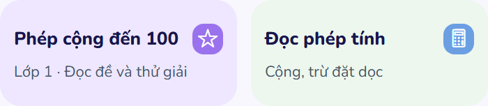

# Student: thu gọn khung đề, chữ hướng dẫn và thẻ gợi ý — 25/10/2026

## Kết quả

- Khung đề vẫn mở sẵn và ghim trên vùng làm bài, nhưng bỏ bóng đổ, giảm bán kính bo góc, header/đệm và chiều cao phần nội dung. Lời nhắc cuộn được gộp vào header, không chiếm một hàng riêng phía dưới.
- Trên viewport 390×844, chiều cao khung đề đo được **154px**, so với **262px** ở vòng kiểm tra trước: giảm **41,2%**. Đề dài và ảnh vẫn cuộn bên trong; nút mở/thu gọn và chỉnh đề vẫn có vùng chạm 48px.
- Chữ đề 13/20px; nội dung hướng dẫn 14/21px; câu hỏi 16/23px; lựa chọn 15/21px; tiêu đề bước 17/23px. Thu khoảng cách trong thẻ, khối tiêu đề và các lựa chọn. Nội dung lời giảng trong bảng nghe là 14/22px.
- Thẻ bài học gợi ý chuyển icon nhỏ sang bên phải tiêu đề; mô tả dùng bề rộng thẻ. Không ép chữ vào cột hẹp cạnh icon lớn. Chiều cao đo **76px**, thay cho `minHeight: 108` trước đây. Tiêu đề **Phép cộng đến 100** nằm một dòng ở cả sáu kích thước thử nghiệm, không cắt chữ hoặc chèn ngắt dòng cưỡng bức. Màn hình hẹp/chữ lớn vẫn dùng bố cục dọc có sẵn.
- Luồng học, đề gốc, câu hỏi, đáp án, âm thanh và các nút thao tác được giữ nguyên. Không khóa khả năng phóng chữ của hệ điều hành.

## Kiểm chứng

- **63/63 test** qua: tutor screen, home responsive actions, lesson listening và lesson narration.
- TypeScript và ESLint năm file giao diện thay đổi qua; `git diff --check` qua.
- Xuất web và bundle Android thành công.
- Bản web thật được kiểm tra tại **320×568, 360×800, 390×844, 768×1024, 844×390, 1440×900**. Đo chiều cao khung đề/thẻ, kiểm tra tiêu đề không rớt dòng, hai thẻ cân nhau, vùng chạm, đề vẫn ghim khi cuộn, và phóng chữ CSS 160%. Kiểm tra thẻ không bị thanh điều hướng dưới che.
- **20 ảnh render**, không lỗi JavaScript/tràn ngang. [Kết quả đo](student-compact-layout-20261025/visual-qa.json), [script QA](student-compact-layout-20261025/visual-qa.cjs).
- Dữ liệu đăng nhập/bài học được giả lập riêng cho QA; phần nghe dùng WAV tổng hợp có sẵn. Đây là kiểm tra trình duyệt và bundle, chưa phải kiểm tra trực tiếp trên điện thoại Android. Cỡ chữ lớn được mô phỏng bằng CSS trên web.

[Ảnh bài học mở đề](student-compact-layout-20261025/screenshots/lesson-expanded-390.png) · [Ảnh lời giảng](student-compact-layout-20261025/screenshots/narration-390.png)

## Skills Applied

- `ui-ux-pro-max`
  - SKILL.md: `.agents/skills/ui-ux-pro-max/SKILL.md`
  - Why selected: sửa mật độ bố cục và tiêu đề xuống dòng không cân đối.
  - Applied to: khung đề, typography bước học, cấu trúc thẻ gợi ý và QA responsive.
- `vercel-react-best-practices`
  - SKILL.md: `.agents/skills/react-best-practices/SKILL.md`
  - Why selected: triển khai trên component React Native/Web hiện có.
  - Applied to: tái sử dụng trạng thái đo nội dung và bố cục thích ứng, không thêm dependency hoặc effect mới.
- `fixing-accessibility`
  - SKILL.md: `.agents/skills/fixing-accessibility/SKILL.md`
  - Why selected: thu nhỏ giao diện nhưng vẫn giữ khả năng thao tác và đọc.
  - Applied to: vùng chạm 48px, tên nút, trạng thái expanded, cuộn bàn phím, độ tương phản chữ và kiểm tra chữ lớn.
