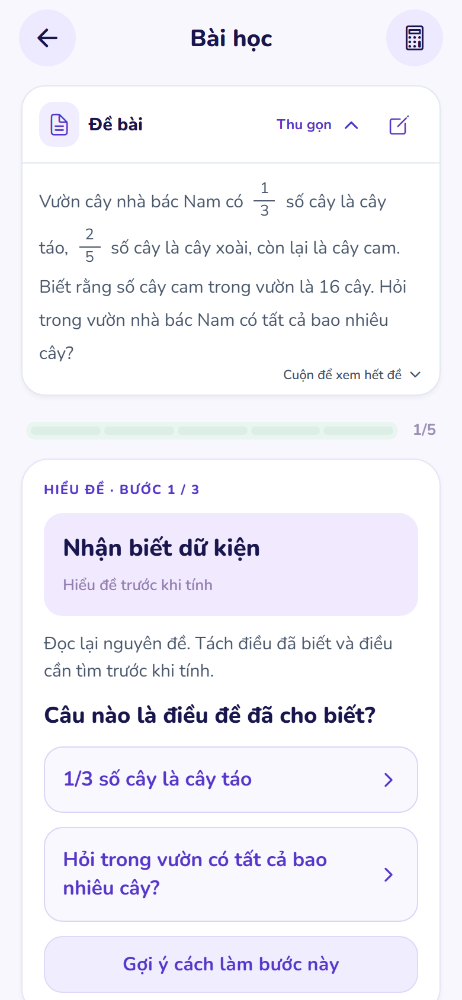
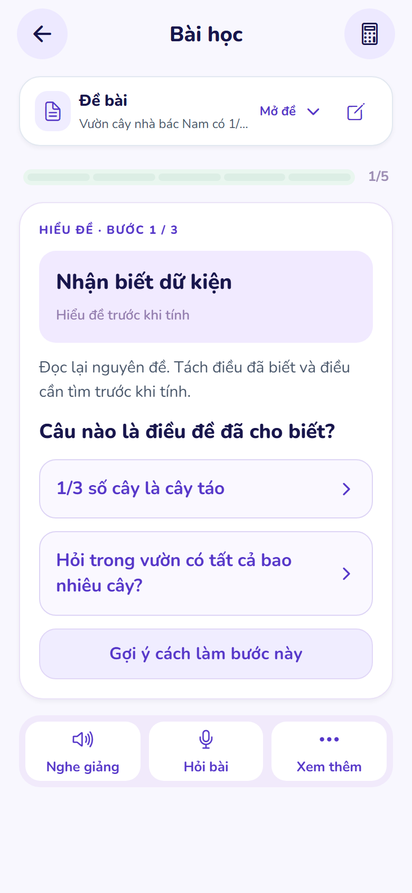

# Student: đề bài luôn ở trên vùng làm bài — 25/10/2026

## Thay đổi

- Khung đề bài mở sẵn khi bắt đầu học và nằm ngoài vùng cuộn của bước học. Cuộn câu hỏi, đáp án hoặc gợi ý không làm mất đề.
- Nút **Thu gọn / Mở đề** thao tác ngay tại chỗ; giữ trạng thái khi trả lời và chuyển bước trong cùng phiên học. Thanh thu gọn có một dòng xem trước.
- Nội dung đề dài cuộn riêng trong khung có chiều cao giới hạn theo màn hình, có lời nhắc cuộn khi cần. Có thể cuộn bằng bàn phím trên web. Số và phân số vẫn dùng `MathText`; ảnh đề đã che thông tin vẫn xem được trong khung.
- Nút chỉnh đề giữ luồng xác nhận dữ kiện hiện có. Khung đề và phần mở/thu gọn có tên truy cập, trạng thái expanded và liên kết nội dung tương ứng.
- Bỏ **Xem lại đề bài** và **Máy tính** trong **Xem thêm**. Máy tính vẫn ở đầu trang. Video, lưu bài, tóm tắt, bài đã viết và hình phân số vẫn xuất hiện khi phù hợp với bước học.
- Bỏ bản đề trùng ở sidebar laptop. Giữ màn đọc ảnh/chuẩn bị độc lập, luồng che thông tin/cắt ảnh, và nội dung học do backend quyết định.

Nguyên nhân trước đó: khung đề cũ chỉ render khi `!lesson`, khiến nhánh mở/thu gọn cho `lesson` bên trong không thể xuất hiện. Đề lúc học chỉ còn trong bảng công cụ phụ.

## Kiểm tra

- Tutor screen: **52/52 test qua**, gồm mở sẵn/thu gọn/mở lại, chỉnh đề, xác nhận dữ kiện, trạng thái khi chuyển bước và menu không còn mục trùng.
- TypeScript qua; ESLint hai file giao diện thay đổi qua; `git diff --check` qua.
- Xuất web thành công; bundle Android thành công.
- Kiểm tra trình duyệt trên bản web xuất từ code thật: **320×568, 390×844, 844×390, 768×1024, 1440×900**. Đo vị trí khung đề trước/sau khi cuộn bước học; kiểm tra menu, mở bằng Enter, đề dài cuộn riêng, cuộn bàn phím và chữ phóng 160%. Không tràn ngang, không lỗi JavaScript.
- **17 ảnh chụp** trong [thư mục minh chứng](student-lesson-reference-20261025/screenshots/); [kết quả đo](student-lesson-reference-20261025/visual-qa.json); [script kiểm tra](student-lesson-reference-20261025/visual-qa.cjs).
- Trình duyệt dùng tài khoản và phản hồi bài học giả lập riêng cho QA, không thay đổi dữ liệu thật. Kiểm tra chữ lớn là kiểm tra CSS trên web. Chưa kiểm tra trực tiếp trên điện thoại Android trong lượt này.

## Skills Applied

- `ui-ux-pro-max`
  - SKILL.md: `.agents/skills/ui-ux-pro-max/SKILL.md`
  - Why selected: giữ ngữ cảnh đề bài và giảm công cụ trùng trong bố cục học.
  - Applied to: khung ghim, giới hạn chiều cao, nội dung dài, kích thước nhỏ/lớn và kiểm tra ảnh render.
- `vercel-react-best-practices`
  - SKILL.md: `.agents/skills/react-best-practices/SKILL.md`
  - Why selected: thay đổi component React Native/Web và vòng đời trạng thái.
  - Applied to: trạng thái mở/thu gọn gắn theo session, đo nội dung và tính điều kiện hiển thị trực tiếp khi render.
- `fixing-accessibility`
  - SKILL.md: `.agents/skills/fixing-accessibility/SKILL.md`
  - Why selected: thay đổi nút mở/thu gọn và vùng cuộn.
  - Applied to: tên truy cập, expanded/controls, icon trang trí, mục tiêu chạm 48px, focus và bàn phím.
