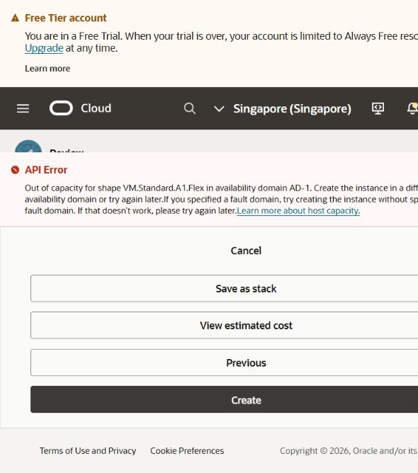
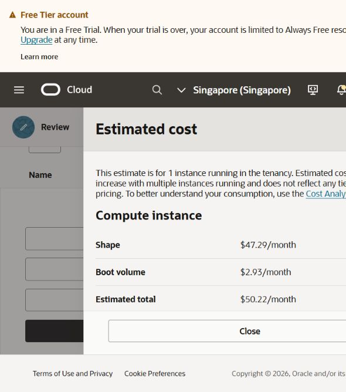
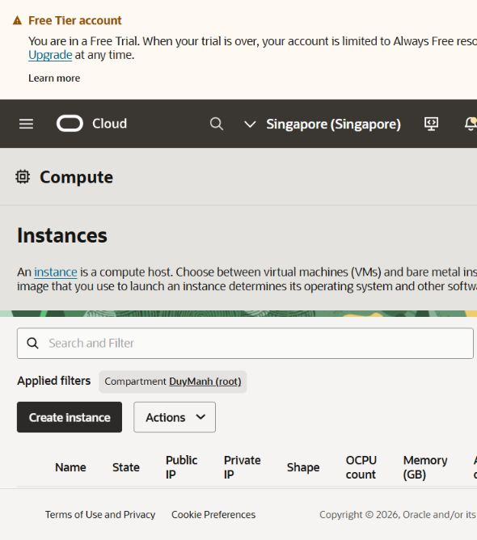

# Cloud capacity investigation — 11 October 2026

## Current outcome

Cloud migration remains incomplete. The owner renewed the `DuyManh` Console sign-in. The Singapore root compartment initially showed no instances. Two new provisioning requests were then submitted and rejected for host capacity:

| Request | Image / disk | Result |
| --- | --- | --- |
| `mathvisionkid-cloud`, A1 Flex, 1 OCPU / 6 GB | Ubuntu 24.04 Minimal ARM64; 50 GB / 10 VPU; in-transit encryption | `Out of capacity for shape VM.Standard.A1.Flex in availability domain AD-1` |
| `mathvisionkid-api`, E2 Micro, 1 GB | Ubuntu 24.04 Minimal AMD64; same disk settings | `Out of capacity for shape VM.Standard.E2.1.Micro in availability domain AD-1` |

Both used on-demand capacity, automatic fault-domain placement and the existing approved public SSH key. No public IPv4 was assigned in either draft; a successful launch would still require restricted network configuration before SSH. No Oracle SSH session or public cloud endpoint has been established.

## Concrete trial alternative — declined by owner

The Oracle subscription Usage page showed 29 of 30 days remaining, 100% credit remaining, SGD 400.00 credit remaining and SGD 0.00 used. This is trial credit, not a bank balance. The account remains a Free Trial; no paid upgrade was made.

A complete, unsubmitted creation draft was prepared for `mathvisionkid-trial`: E5 Flex, 1 OCPU / 8 GB RAM, Ubuntu 24.04 Minimal AMD64, 50 GB / 10 VPU encrypted boot volume, automatic fault-domain placement in Singapore AD-1, and the same public SSH key. Public IPv4 was No in the draft. The draft was subsequently closed without submitting Create.

Oracle's Estimated cost panel displayed shape `$47.29/month`, boot volume `$2.93/month`, total `$50.22/month`. The panel uses `$` without an explicit currency label; the subscription itself is denominated in SGD. Do not relabel the estimate as USD or claim a full application cost: networking and other service consumption are not all represented in this panel. Host capacity for E5 is not yet tested.

The owner explicitly responded: only free, no spending. The agent respected that response, closed both the cost panel and E5 creation draft, and retained Always Free as the authorized route. No E5 Create request was submitted. Credit-funded resources may be reclaimed when the trial ends; no automatic billing upgrade or promise of permanent free uptime is made.

After the requests and draft cancellation, the Singapore root-compartment lists for Instances, VCNs, Block Volumes and Boot Volumes each showed no items. No data deletion was necessary. The resource blocker remains Oracle host capacity, not an SSH authentication error.

Yesterday's A1 requests and the first E2 Micro request were rejected for host capacity. The empty inventory and the local model resource check are recorded in [the E2 fallback report](cloud-e2-fallback-2026-10-10.md). That model-only check does not establish that the full OCR API and queued worker fit on a 1 GB VM.

## Bounded Oracle retry after sign-in

1. Inspect existing instances, disks and networks before creating anything, and read the actual trial balance and account status.
2. Retry an approved Always Free shape with automatic fault-domain placement. A smaller A1 allocation is another candidate within the free allowance, but complete-stack memory must be measured before migration is declared successful.
3. Stop after a clear capacity rejection rather than repeatedly submitting identical requests. Changing CLI versus Console does not establish a different capacity pool.
4. If a host is allocated, verify its restricted network access, SSH, restored data, authentication, real queued OCR and persistence before changing the Vercel backend destination.

Oracle documents changing shape, availability domain or fault domain, including leaving fault-domain selection automatic, as capacity workarounds. The previously observed Singapore Console offered only AD-1. [Oracle capacity troubleshooting](https://docs.oracle.com/en-us/iaas/Content/Compute/Tasks/troubleshooting-out-of-host-capacity.htm).

Always Free compute is restricted to the account's home region. Switching regions therefore does not establish another permanently free deployment. Oracle also offers trial credits of $300 for up to 30 days; credit-funded paid resources are reclaimed after the trial unless billing is upgraded. [Oracle Free Tier](https://docs.oracle.com/en-us/iaas/Content/FreeTier/freetier.htm).

## Alternative assessment

These are documented service limits, not proof of eligibility, available capacity or a working deployment for this owner.

| Option | Relevant limit | Assessment for the current application |
| --- | --- | --- |
| Existing Oracle trial | Up to $300 / 30 days; paid resources reclaimed after trial | A different x86 shape may support a temporary deployment. Requires checking remaining credit, reviewing the actual configuration and the owner's approval of the expiry tradeoff. |
| Google Cloud Free Trial | Eligible new users: $300, up to 90 days; resources stop when trial ends | Another temporary VM route requiring registration and eligibility verification. No claim of permanent free operation. |
| AWS Free account plan | Eligible new accounts: initial $100 plus earned credits, up to six months or credit exhaustion | Temporary route; account closes when the free plan expires. New registration and resource selection are still required. |
| Hugging Face Spaces | New Docker/Gradio compute Spaces require PRO or Team; limited ZeroGPU exception | Legacy advice about an unrestricted free Docker server does not fit the current policy or unchanged stack. |
| Koyeb Free Instance | 512 MB, 0.1 vCPU, no volumes or worker service; sleeps after inactivity | Does not accommodate this unchanged persistent backend/OCR stack. |
| Render Free services | Web service sleeps after inactivity; ephemeral files; free database expires | Does not provide the requested unchanged persistent 24/7 deployment. |

Sources: [Google Cloud trial](https://docs.cloud.google.com/free/docs/free-cloud-features), [AWS free account plans](https://docs.aws.amazon.com/awsaccountbilling/latest/aboutv2/free-tier-plans.html), [Hugging Face Spaces](https://huggingface.co/docs/hub/spaces-overview), [Koyeb instances](https://www.koyeb.com/docs/reference/instances), [Render free services](https://render.com/docs/free).

## Validation and scope

- Observed renewed Console access, the initial empty instance list, both request errors, subscription Usage and the E5 estimate directly. Saved screenshots of errors and estimate above; account-specific trial evidence is in the existing private artifact directory at `infra/local-runtime/cloud-migration/oracle-trial-credit-2026-10-11.png`.
- Consulted official provider documentation for the options above.
- No billing upgrade, new account, successfully provisioned VM, new credentials, data transfer, application-source edit, training, Git commit or push occurred in this investigation. Two approved Always Free requests were submitted and failed; the unsubmitted E5 draft was closed after the owner's decision.
- Existing websites still require the PC-hosted backend. PC-off operation has not been verified.

## Skills Applied

Skills Applied: None — no installed skill matched the cloud-capacity investigation and provider-policy comparison. The workspace skill registry was inspected; no implementation skill was applied.
