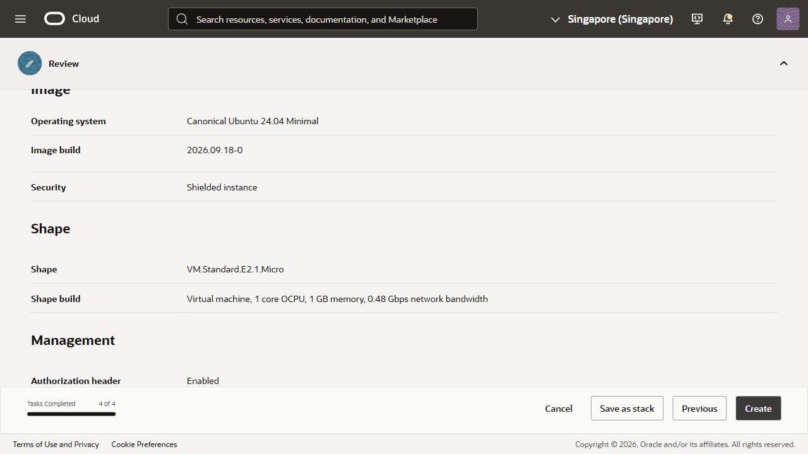
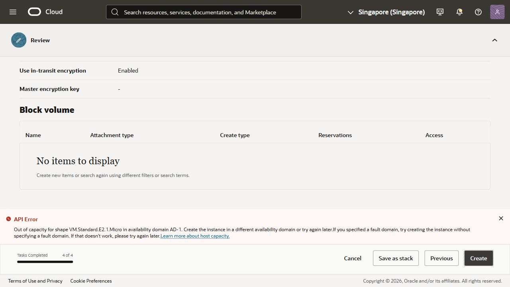

# Oracle E2 Micro fallback — 10 October 2026

## Outcome

The first authorized E2 Micro request failed with Oracle's explicit `Out of capacity for shape VM.Standard.E2.1.Micro in availability domain AD-1` error. No Oracle VM, VCN or disk was provisioned. The websites still depend on the existing PC backend; operation with that PC off has not been established.

The owner confirmed two Always Free instances at action time, including use of the existing dedicated SSH key, public web ports, SSH restricted to the owner's IP and private backend–OCR communication. The approved plan was:

| Node | Purpose | Shape and OS | Disk |
| --- | --- | --- | --- |
| `mathvisionkid-api` | Backend, database, private storage and gateway | E2 Micro, Ubuntu 24.04 Minimal AMD64 | 50 GB, 10 VPU, in-transit encryption |
| `mathvisionkid-ocr` | AI API, queued worker and Redis | Same | Same |

The first request used Singapore AD-1, automatic fault-domain placement and the existing public SSH key. The draft did not assign a public IPv4 address; a successful provision would still require explicitly configuring its restricted network access. No public endpoint or SSH session exists. The second request was not submitted after the first failed: an identical shape in the same availability domain has the same capacity dependency.

After closing the rejected draft, the Singapore root-compartment inventories for Instances, Virtual Cloud Networks, Block Volumes and Boot Volumes each showed no items. No deletion was needed. No billing upgrade, paid shape, duplicate trial account, data upload or Vercel backend change was performed.

Reviewed configuration:

Oracle rejection:

## Resource feasibility check

An isolated local container ran the real runtime model compatibility script from the existing AMD64 AI image. It used read-only model/check mounts, no network or provider credentials, one numerical-library thread, a 512 MiB memory/swap limit and a 0.125 CPU limit. It did not select or modify the running PC preview containers.

- Four model checksums passed.
- CRNN, YOLO and OpenCV ONNX CPU inference passed.
- Model check elapsed time: 68.0 seconds.
- Peak process RSS: 438,592 KiB.
- Cgroup peak memory: 536,870,912 bytes, exactly the imposed memory limit.
- Container exited with code 0; `OOMKilled=false`.

An initial wrapper invocation lacked `/checks` on `PYTHONPATH` and failed to import the preflight helper. The corrected wrapper used `/app:/checks` and produced the results above. This was a test-harness issue, not a deployed application failure.

The successful model-only check does not prove the complete E2 deployment fits. Both the API and worker can load models, and each VM must also accommodate its operating system and supporting services. Two 1 GB machines cannot pool their RAM. Local container CPU throttling is not a measurement of Oracle burst behavior. No photographed-question accuracy, native server latency, queued-job completion or physical-device evidence is claimed.

The disposable model-check container was removed and no matching test container remained. A final scoped container status check showed the PC preview AI, worker, backend, PostgreSQL, Redis and MinIO healthy; its gateway and tunnel remained running. Local documentation links and screenshot artifacts passed existence checks; focused whitespace validation passed. These checks do not establish internet login or cloud deployment.

## Remaining gates

1. Oracle must provide free host capacity. Check inventory before a bounded retry; do not upgrade billing or switch to a paid shape automatically.
2. If E2 becomes available, implement and verify the split private-network configuration with measured memory limits, then test complete backend auth and a real queued OCR job. Do not use the single-VM ARM64 deployment commands as an E2 profile.
3. Transfer the existing verified backups and runtime model bundle only to the authorized server, restore them and confirm persistence after restart.
4. Establish stable HTTPS, restrict public routes and publish all three websites against that endpoint.
5. Verify login and real-photo OCR from another device/network with the owner's PC off before reporting migration complete.

No model training, Student Mobile source change, Git commit or push occurred in this fallback phase.

## Skills Applied

- `ponytail`
  - SKILL.md: `.agents/skills/ponytail/SKILL.md`
  - Why selected: Reuse the existing application and check the small-resource fallback before adding deployment machinery.
  - Applied to: Bounded model resource check, provisioning preparation and truthful deployment documentation. A speculative split-stack implementation was deferred because no host was provisioned.

## References

- [Oracle Always Free resources](https://docs.oracle.com/en-us/iaas/Content/FreeTier/freetier_topic-Always_Free_Resources.htm): E2 Micro sustained CPU, memory and free resource limits; host-capacity availability.
- [Existing migration preparation](cloud-migration-preflight-2026-10-10.md).
- [Free cloud deployment guide](../docs/FREE_CLOUD_DEPLOYMENT.md).
- [Expo 57 documentation](https://docs.expo.dev/versions/v57.0.0/) was read before implementation; no Expo source changed.
