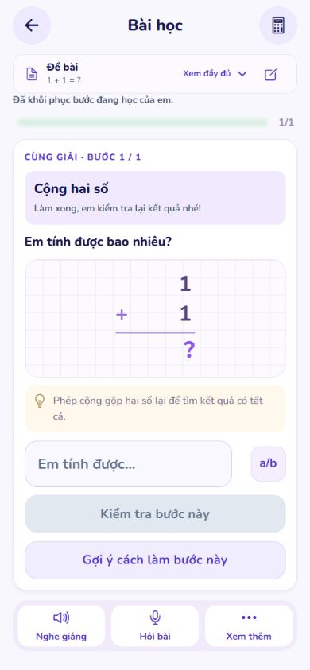
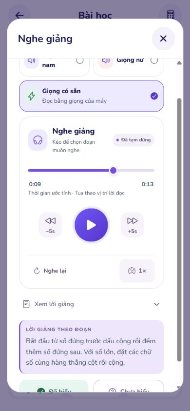

# Giọng có sẵn và bài toán ngắn — 02/11/2026

Đã sửa trong checkout đang chạy `E:/MathVisionKid`. Chưa commit hoặc push trong đợt này.

## Nguyên nhân đã xác định

- Thanh giọng thiết bị từng chặn tiến độ ở cuối thời lượng ước tính của từng câu. Khi máy nói chậm hơn ước tính, thanh đứng chờ dù vẫn đang đọc.
- Slider Android mặc định chỉ có 128 vị trí nếu không đặt `step`. Vì vậy cập nhật đồng hồ thường xuyên vẫn có thể cho hình ảnh đứng rồi nhảy.
- Đổi độ dài dải slider trong lúc hiệu chỉnh thời lượng còn gây dịch chuyển nhỏ do làm tròn. Đã chuyển sang dải cố định 0–1, với 10.000 nấc; thao tác tua vẫn được đổi về giây.
- Luồng bài học trước đây bắt buộc ít nhất hai bước toán. Điều này không phù hợp bài chỉ có một phép tính hoặc một câu trắc nghiệm.
- Kiểm tra bổ sung phát hiện cách đọc “không trăm linh năm” mất các số 0 đầu phần thập phân, cùng kết quả bài thập phân bị trình bày thành phân số. Hai vấn đề đã có hồi quy và được sửa.

## Thay đổi

- Giọng có sẵn dùng một đồng hồ liên tục cho lượt đọc, theo khung hình và đồng hồ đơn điệu. Sự kiện từ máy đọc hiệu chỉnh ước tính, không kéo thanh về sau.
- Gộp các câu ngắn trong cùng đoạn để giảm lần khởi động lại bộ đọc; dừng đồng hồ khi tạm dừng, đóng phần nghe, rời trang hoặc đưa ứng dụng vào nền.
- Vị trí ước tính không vượt ra ngoài đoạn máy đang đọc khi thiết bị không cung cấp sự kiện vị trí từ. Nghe tiếp không tự quay về đầu đoạn sau.
- Giữ nút lùi/tiến 5 giây ở trình phát dùng chung. Khi dùng giọng thiết bị, vị trí tua được quy về từ gần nhất, không giả là tệp âm thanh có thời lượng đo sẵn.
- Ghi nhớ tốc độ đọc theo mã giọng trong bộ nhớ, tối đa tám giọng. Chỉ học từ lượt đọc trọn vẹn không bị ngắt; không lưu nội dung bài hoặc âm thanh, không huấn luyện model.
- Bài ngắn rõ ràng được giải và kiểm tra bằng số hữu tỉ chính xác; không gọi dịch vụ sinh bài cho các dạng được nhận ra chắc chắn.
- Một phép tính mở ngay một bước phù hợp và hiện phép tính ngay. Không thêm câu hỏi đọc hiểu cho đủ số bước. Giảng phép cộng, trừ, nhân, chia và số thập phân theo thao tác tương ứng.
- Bài trắc nghiệm ngoài bộ phân tích chính xác vẫn có thể qua bước kiểm chứng độc lập. Đáp án cuối dạng lựa chọn phải khớp nguyên văn kết quả kiểm chứng; phép tính vẫn đối chiếu giá trị chính xác và đơn vị.
- Giữ xác nhận nguồn, phân quyền, tách tài khoản, kiểm tra đáp án và điều kiện thiếu dữ kiện. Không dùng đáp án mẫu để đoán bài.
- Định dạng thập phân khi phù hợp bằng phép toán số nguyên, không làm tròn số thực; giá trị nội bộ dùng cho kiểm tra và phụ thuộc giữa các bước vẫn chính xác.
- Sửa cảnh báo SVG trên web và thông báo phiên hết hạn còn sót sau khi mở bài mới thành công.

## Sáu câu trong ảnh

| Dạng | Kết quả đã kiểm tra |
|---|---|
| Đếm phân số thập phân trong 18/10; 32/500; 99/100; 51/1000 | 3; xét mẫu số đang viết, không đổi 32/500 trước khi phân loại |
| Số bằng 0,85 | 0,850 |
| “năm mươi lăm phẩy hai mươi hai” | 55,22 |
| 1,7 km² đổi sang ha | 170 ha |
| Hỗn số 2 và 5/100 thành phân số thập phân | 205/100; giữ yêu cầu về dạng mẫu số |
| 17/25 + 32/15 | 211/75 |

Đã kiểm tra thêm `1+1`, biểu thức có ngoặc, số thập phân, phân số, đổi đơn vị, các bộ toán hạng khác nhau và các nguồn mâu thuẫn/không rõ. Không tự chọn một bài khi nguồn có nhiều câu độc lập.

## Bằng chứng

- Toàn bộ AI runtime: **2.388 qua, 7 bỏ qua, 4 cảnh báo**. Không xem các ca bỏ qua là bằng chứng đã kiểm tra thành công.
- Student: **114 bộ / 1.329 ca qua** ở lượt chốt cuối. Kết quả được lưu trong [checks.json](checks.json).
- Backend: **41 bộ / 487 ca được đăng ký, 1 bỏ qua, 0 thất bại, 0 lỗi**.
- TypeScript và ESLint trong phạm vi thay đổi đã qua; xuất web và Android thành công. Các lần chốt cuối cũng được ghi trong `checks.json`.
- HTTP thật qua máy chủ local đã đăng nhập: **13 bài**, mở một bước và hoàn thành đúng. Chạy thêm nguồn với owner mới để kiểm tra đường chưa có cache theo tài khoản. Số đo cụ thể nằm trong [runtime-results.json](runtime-results.json); không phải thời gian trên điện thoại hoặc mạng khác.
- Trình duyệt thật: lấy **770 mẫu** trong khoảng **13,5 giây** của một lượt đọc đến hết; **0 lần thanh lùi**, lượt nghe tiếp **0 lần lùi**, lúc tạm dừng **0 thay đổi vị trí**. Xem [voice-clock-browser.json](voice-clock-browser.json).
- Giao diện thật: bài `1+1` mở một bước, hiện phép tính ngay và chấp nhận kết quả `2`; câu trắc nghiệm đổi đơn vị giữ lại lựa chọn sai để chọn lại, rồi giữ toàn bộ lựa chọn khi đã chọn đúng.
- Kiểm thử hồi quy còn mô phỏng máy không gửi vị trí từ, đọc lâu hơn dự đoán, sự kiện cũ đến muộn, đổi tốc độ, tua, đổi giờ hệ thống, rời trang và ứng dụng vào nền.

## Giới hạn thực tế

Giọng thiết bị không cung cấp tệp âm thanh hay thời lượng đo trước trong API đang dùng. Thời gian và vị trí tua trước khi nghe hết vẫn là ước tính; tốc độ phụ thuộc bộ đọc và giọng được cài trên máy. Không có bằng chứng Android vật lý cho bản sửa mới này, và không khẳng định thời lượng phải bằng hai giọng trực tuyến. Tham khảo [Expo Speech v57](https://docs.expo.dev/versions/v57.0.0/sdk/speech/).

Bộ phân tích nhanh chỉ nhận những cấu trúc đã kiểm tra đầy đủ. Nguồn khác tiếp tục qua luồng sinh và kiểm chứng; nguồn thiếu, mâu thuẫn, ảnh chưa đọc rõ hoặc dịch vụ mất kết nối vẫn cần được xử lý trung thực. Không cam kết mọi đầu vào đều có đáp án, không tắt kiểm chứng để làm thông báo lỗi biến mất.

## Skills Applied

- `fixing-motion-performance`
  - SKILL.md: `.agents/skills/fixing-motion-performance/SKILL.md`
  - Why selected: tiến độ và nút kéo giọng bị khựng.
  - Applied to: đồng hồ theo khung hình, vòng đời hoạt động, dải slider cố định và kiểm tra mẫu chuyển động.
- `vercel-react-best-practices`
  - SKILL.md: `.agents/skills/react-best-practices/SKILL.md`
  - Why selected: React/React Native và kiểm soát cập nhật giao diện.
  - Applied to: tách cập nhật đồng hồ khỏi callback phần lời giảng, giữ state/ref và hủy tác vụ cũ đúng vòng đời.
- `ponytail`
  - SKILL.md: `.agents/skills/ponytail/SKILL.md`
  - Why selected: sửa nguyên nhân ở phần dùng chung, tránh thêm thư viện.
  - Applied to: tái sử dụng player, tính chính xác bằng thư viện chuẩn, thay đổi ít hợp đồng và giữ kiểm tra ở ranh giới.
- `computer-use`
  - SKILL.md: `C:/Users/Admin/.codex/plugins/cache/openai-bundled/computer-use/26.1027.30824/skills/computer-use/SKILL.md`
  - Why selected: kiểm tra giao diện local thật.
  - Applied to: đăng nhập demo, mở bài ngắn, phát/tua/tạm dừng, lấy mẫu DOM và ảnh chụp; không giả lập bằng chứng thiết bị vật lý.
