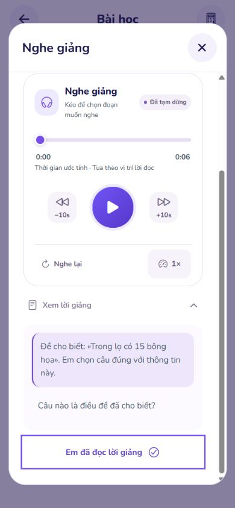
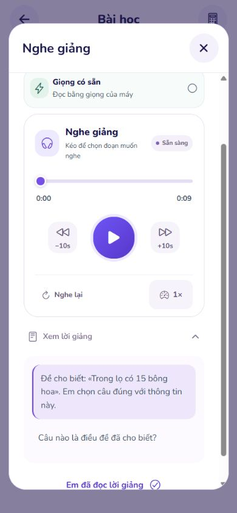

# Đồng bộ bộ phát Giọng có sẵn — 02/11/2026

## Thay đổi

- Giọng có sẵn dùng `MediaTimeline`, cùng giao diện phát/tạm dừng, thanh kéo, lùi/tiến 10 giây, nghe lại và tốc độ 0,8×/1×/1,2× như giọng nam/nữ. Không thêm thư viện hoặc yêu cầu tạo giọng trên máy chủ.
- `LessonNarration` nhận vị trí theo lời đọc để hiển thị đoạn đang nghe bên dưới; mở lời giảng đầy đủ rồi bấm một đoạn sẽ nghe từ đoạn đó. Quiz dùng chính `LessonNarration`, nên nhận cùng thay đổi.
- Tạm dừng giữ vị trí; nghe tiếp từ từ đang đọc khi có sự kiện vị trí chữ. Đổi bài đặt lại bộ phát; đóng màn hình, chuyển app hoặc đổi giọng sẽ ngắt lời đọc. Các sự kiện muộn của lượt cũ/đoạn cũ không thay đổi bộ phát mới và không báo hoàn thành hai lần.
- Chặn bộ phát thiết bị khi bài học đang bị vô hiệu hóa.
- Web: nếu danh sách giọng ban đầu còn rỗng, chờ sự kiện `voiceschanged` tối đa một giây rồi dọn listener; danh sách đã sẵn sàng trả ngay. Không tự phát trong khi dò giọng.

## Giới hạn và cách thể hiện đúng

Giọng thiết bị không cung cấp tệp âm thanh hoặc thời lượng đã đo. Thanh kéo ánh xạ đến vị trí từ trong nội dung đã chuẩn hóa cách đọc toán, không hứa tua chính xác đến mili giây như tệp WAV. Giao diện ghi **“Thời gian ước tính · Tua theo vị trí lời đọc”**, kể cả thông tin cho trình đọc màn hình. Mốc thời gian ước tính từ chiều dài lời đọc, cập nhật theo sự kiện vị trí từ nếu bộ đọc cung cấp; bộ đọc không có sự kiện từ dùng đồng hồ ước tính trong đoạn. Chỉ sự kiện đọc xong mới xác nhận hoàn thành, đồng hồ ước tính không tự đánh dấu đã nghe xong.

[Tài liệu Expo Speech v57](https://docs.expo.dev/versions/v57.0.0/sdk/speech/) mô tả `onBoundary`, `stop()` và giới hạn `pause()`/`resume()` trên Android. Triển khai dùng dừng và đọc tiếp từ vị trí chữ để có thao tác nhất quán giữa các nền tảng. Khi nghe tiếp có thể lặp lại từ cuối cùng, tùy tín hiệu bộ đọc của máy.

## Kiểm tra

- Student Jest: **114 bộ / 1.317 kiểm thử qua**. Kiểm tra hồi quy có tua ở giữa nội dung, kéo khi đang phát/đang dừng, tiếp tục từ từ đã đọc, đổi tốc độ, nghe lại, chuyển nền, đóng lúc đang mở phiên âm thanh, phản hồi cũ và hoàn thành trùng, thiếu giọng Việt, danh sách giọng nạp chậm, bộ đọc không khởi động, ánh xạ lời giảng và Quiz.
- TypeScript và ESLint các tệp sản phẩm thay đổi: qua.
- Export web + Android: qua khi cung cấp địa chỉ dịch vụ HTTPS theo cấu hình kiểm tra. Hai lần gọi trước thiếu cấu hình hoặc dùng địa chỉ local đã bị kiểm tra cấu hình production từ chối đúng quy tắc; không nới kiểm tra hoặc đổi cấu hình chạy hiện tại để vượt qua. Artifact nằm trong `.local-artifacts/device-voice-controls-20261102/export`, không phải bản đã triển khai.
- Student Web thật: đăng nhập tài khoản demo, mở bài trong kho đề, mở lời giảng, kiểm tra bộ điều khiển dùng chung tại chiều rộng 320, 390 và 768. Thanh kéo thao tác bằng bàn phím cập nhật 0 → 0,05 giây; thẻ điều khiển nằm trong bề rộng màn hình ở 320 và 768.
- Khi mở lần đầu, trình duyệt trả danh sách giọng rỗng; sau khi nạp xong đã có giọng Việt. Sau sửa chờ sự kiện, reload trang và mở Giọng có sẵn đã thấy bộ phát Sẵn sàng ngay trong lượt kiểm tra, không cần bấm thử lại. Đã bấm Phát trên bộ đọc trình duyệt thật: nhận sự kiện đọc xong, thanh chuyển tới cuối và giao diện mở hai nút Đã hiểu/Chưa hiểu. Thử Home/End trên thanh tua khi đang dừng giữ trạng thái dừng và không tự gọi hoàn thành lời giảng. Đây là kiểm tra sự kiện bộ đọc trên web, **chưa xác nhận âm thanh qua loa Android/iOS thật**; các trường hợp lỗi/race dùng bộ đọc mô phỏng trong kiểm thử.

Ảnh giọng có sẵn thực tế trên Student Web:

Ảnh dưới chụp bộ điều khiển thực tế trên Student Web với **giọng nam đang được chọn** để đối chiếu giao diện dùng chung, không phải bằng chứng phát giọng thiết bị:

## Skills Applied

- `ui-ux-pro-max`
  - SKILL.md: `.agents/skills/ui-ux-pro-max/SKILL.md`
  - Why selected: Đồng bộ giao diện điều khiển và cách hiển thị trạng thái.
  - Applied to: Dùng lại bố cục, nút bấm, thanh kéo có bàn phím và thông tin thời gian ước tính.
- `vercel-react-best-practices`
  - SKILL.md: `.agents/skills/react-best-practices/SKILL.md`
  - Why selected: Điều khiển React Native có sự kiện âm thanh bất đồng bộ.
  - Applied to: Memo hóa mốc lời đọc; giữ trạng thái phiên trong ref; đặt lại bằng key khi nội dung đổi; tách vòng đời khỏi cập nhật vị trí/tốc độ.
- `ponytail`
  - SKILL.md: `.agents/skills/ponytail/SKILL.md`
  - Why selected: Sửa tại bộ phát dùng chung với thay đổi giới hạn.
  - Applied to: Tái sử dụng MediaTimeline/LessonNarration và cách đọc toán sẵn có, không thêm thư viện/module native/dịch vụ mới.

Không commit/push trong lượt sửa giao diện này.
