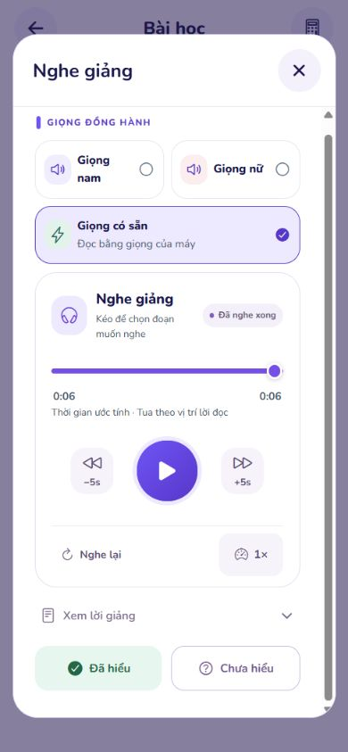

# Sửa thanh thời gian giật lùi và thống nhất tua 5 giây — 02/11/2026

## Nguyên nhân đã xác nhận trong code

`DeviceNarration` trước đây vừa nội suy thời gian bằng đồng hồ, vừa gán thẳng vị trí chữ từ `onBoundary` vào cùng giá trị thanh tua. Mốc chữ có thể đến muộn hơn đồng hồ, nên lần gán sau kéo thanh về phía sau. Tạm dừng/nghe tiếp cũng đặt lại thanh về đầu từ đang đọc. Ngoài ra, cập nhật 250 ms/lần chỉ tạo khoảng bốn lần đổi vị trí mỗi giây.

Đã thêm kiểm thử tái hiện trước khi sửa: trong 12 lần lấy mẫu cách nhau 50 ms, bản cũ chỉ có ba vị trí khác nhau, không đạt điều kiện cập nhật đều. Đoạn gán mốc chữ thấp hơn trực tiếp cũng giải thích đúng hiện tượng người dùng gửi.

## Sửa đổi

- Tách vị trí từ thực tế để nghe tiếp khỏi vị trí hiển thị. Mốc từ hiệu chỉnh tốc độ dần; không được kéo thanh hiển thị lùi trong lúc phát. Bấm tạm dừng, nghe tiếp và đổi tốc độ giữ vị trí hiển thị; kéo thanh, lùi hoặc nghe lại vẫn chủ động đổi vị trí như yêu cầu.
- Cập nhật phần hiển thị trong bộ phát mỗi 50 ms, giới hạn báo vị trí lên phần lời giảng/lưu tiến độ mỗi 250 ms. Không đo lại layout, không thêm thư viện animation. Dừng bộ đếm khi tạm dừng, đổi đoạn, đóng, chuyển nền hoặc lỗi.
- Khi gần cuối thời gian ước tính, thanh chậm lại và chờ bộ đọc xác nhận hoàn thành. Không dùng đồng hồ để tự đánh dấu đã nghe xong.
- Nếu máy không cung cấp sự kiện vị trí từ, tiếp tục dùng vị trí ước tính để nghe tiếp, tránh đọc lại toàn bộ đoạn.
- Nút **−5s / +5s** được đặt tại `MediaTimeline` dùng chung. Bỏ cấu hình riêng 10 giây của `AudioPlayback`; giọng nam, nữ, có sẵn, giọng trả lời, Quiz và nghe lại bản ghi câu hỏi đều nhận mức 5 giây. Tìm trong mã sản phẩm không còn nút giọng 10 giây.

Thời gian giọng thiết bị vẫn là **ước tính theo lời đọc**; không đổi thành tuyên bố thời lượng âm thanh đã đo.

## Kiểm tra

- TypeScript và ESLint các tệp thay đổi: qua.
- Toàn bộ Student Jest: **114 bộ / 1.320 kiểm thử qua**.
- Kiểm thử hồi quy gồm sự kiện từ đến chậm, cập nhật 50 ms, giữ thanh khi dừng/nghe tiếp, tua lùi chủ động, máy không báo vị trí từ và 500 lần lấy mẫu tiến độ giả lập với mốc chữ không đều. Không có giá trị lùi, không vượt cuối đoạn, không tự hoàn thành bằng đồng hồ.
- Export web và Android: thành công, artifact QA trong `.local-artifacts/device-voice-smooth-20261102/export`. Chỉ truyền cấu hình dịch vụ HTTPS vào tiến trình export, không thay cấu hình triển khai.
- Student Web thật, bộ đọc thiết bị của trình duyệt: nút ±5 giây hiển thị đúng. Lấy **20 mẫu trong 1.171 ms**, có **15 lần tiến**, **0 lần lùi**, bước tăng lớn nhất **0,1 giây** trong lượt đo này. Đây là mẫu ngắn trên web, không phải đo FPS hoặc chứng minh trên mọi điện thoại. Kết quả gốc: [browser-samples.json](browser-samples.json).
- Lượt đo 60 mẫu ban đầu vượt thời hạn của công cụ đo trình duyệt nên không được dùng làm số liệu; lượt 20 mẫu hoàn thành. Không coi thời hạn công cụ đo là lỗi ứng dụng.
- **Chưa kiểm chứng chuyển động trên Android/iOS vật lý**. Bộ đọc thiết bị vẫn phụ thuộc giọng Việt trên máy và thời gian chỉ là ước tính.

## Skills Applied

- `fixing-motion-performance`
  - SKILL.md: `.agents/skills/fixing-motion-performance/SKILL.md`
  - Why selected: Thanh tua cập nhật giật và bị kéo lùi.
  - Applied to: Một cơ chế hiển thị có điều kiện dừng; không đọc layout mỗi nhịp; giới hạn vùng và tần suất cập nhật.
- `vercel-react-best-practices`
  - SKILL.md: `.agents/skills/react-best-practices/SKILL.md`
  - Why selected: Đồng bộ sự kiện bộ đọc với React Native.
  - Applied to: Vị trí từ/đồng hồ giữ trong ref, cập nhật UI tại bộ phát và hạn chế báo trạng thái lên cây bài học.
- `ponytail`
  - SKILL.md: `.agents/skills/ponytail/SKILL.md`
  - Why selected: Sửa nguyên nhân ở phần dùng chung.
  - Applied to: Dùng lại MediaTimeline cho tất cả nơi phát giọng, bỏ cấu hình 10 giây riêng, không thêm phụ thuộc hoặc thay dịch vụ giọng.

Không commit/push trong lượt sửa này. Giao diện Student đã được khởi động lại để kiểm tra bản local.
