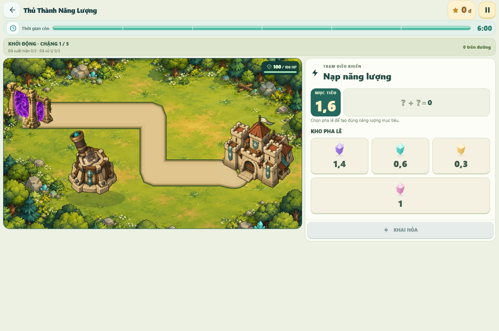

# Tích hợp web, hồ sơ và runtime — 13/11/2026

## Nguồn và quyết định

Owner yêu cầu lấy phần tốt của Four-L và Nam, sửa lỗi đang chạy, kiểm thử rồi phát hành main và production. Nền `dc60d3ca0303767e5200107343a60b753b50d255` đã chứa nguyên commit nguồn PR [#59](https://github.com/NV-DuyManh/MathVisionKid/pull/59) (`312fe3e035aec15cd2a3b12a185afd735e1052f3`) và [#60](https://github.com/NV-DuyManh/MathVisionKid/pull/60) (`997a282cb5bcf358d4febf8169fc3d8a3f0941ab`). Giữ Teacher/Admin/Portal, hợp đồng bàn giao lớp V30/V31, hồ sơ/thành tích và che ảnh V32. Không nhập các thao tác xóa Admin/shared trong checkout cũ.

Các sửa local đã chạy production từ chat VPS nằm trên nền `3f5d18b1e8db13997166c674ad7ab7d90e1dbc7a`, chưa có commit nguồn riêng. Giữ Google login đã được owner dùng, điều khiển phát âm thanh trước khi Safari tải metadata, giọng Việt dự phòng, xác nhận phân số OCR chưa đọc rõ và trình bày game. Không gán tác giả mới cho công cụ hỗ trợ. Phần ghép giữ điều hướng Student `/study/`, SSO một lần và cách ly phiên của Four-L.

PR [#51](https://github.com/NV-DuyManh/MathVisionKid/pull/51) được đóng theo quyền owner. Head `e59520824cdeeb7faaadd499b2f13eb39d89d39f` còn xung đột, cho chấm trạng thái FAILED/NEEDS_RETAKE, làm mất retry/retake/imageVersion và đọc annotation từ khóa localStorage không có owner. Không lấy những đoạn này; bản Teacher hiện tại đã có xoay/zoom/toàn màn hình. [Bình luận quyết định](https://github.com/NV-DuyManh/MathVisionKid/pull/51#issuecomment-6852589822).

## Lỗi xác minh và sửa

- Public API cũ trả 404 cho hồ sơ Student có xác thực; database production mới V29. Bản release cần backend cùng Flyway V30–V32 trước frontend.
- Native bundle mất EXPO_PUBLIC_API_BASE_URL vì đọc env qua bí danh động. Đọc trực tiếp các biến được Expo inlining; test thực sự biến đổi Babel/Android với process.env trống. Giữ ưu tiên host Metro khi dùng mạng phát triển.
- Phân số OCR thiếu tử/mẫu bị đoán tiếp: chặn chuẩn bị Quiz/tutor, yêu cầu xác nhận ảnh, backend ánh xạ đúng lỗi 422. Refresh hash chính sách catalog; 81 đáp án đã được kiểm tra độc lập, không đổi đáp án để né validator.
- Safari có thể chưa tải metadata trước thao tác Play: cho phép mở điều khiển khi duration=0, giữ play trong user gesture, có phục hồi/lựa chọn giọng dự phòng.
- Teacher đổi lớp trong form tạo đợt chấm từng ghi thêm history entry, khiến Back về form trung gian. Thay bằng replace query và kiểm tra Back/Forward trên browser.
- Web dùng một form đăng nhập chung, Google/Firebase dùng phiên trong bộ nhớ; camera điện thoại có đường chọn ảnh/chụp bằng file picker khi stream không khả dụng. Android giữ nội dung trả lời trên bàn phím; chưa xác minh lại trên thiết bị vật lý trong lượt này.

## Kiểm tra local trên cây nguồn dùng cho PR

Logs và bản backup checkout nằm ngoài Git tại thư mục sibling `runtime-games-fix`, không chứa trong artifact công khai. Các ca browser offline dùng API tổng hợp, không được tính là nghiệm thu dịch vụ thật.

| Lệnh/nhóm | Kết quả |
|---|---|
| `npm run check:governance` | 16/16 đạt; rulesets GitHub live đang active |
| `npm run test:browser` | 112/112 desktop/mobile đạt trên build Portal/Teacher/Admin |
| `npm exec -- playwright test --config playwright.student.config.mjs` | 27 đạt, 1 skip đúng điều kiện desktop không kiểm orientation cảm ứng |
| `npm test --workspace=student-mobile -- --runInBand` | 1.493/1.493, 120 suites đạt; sau sửa bàn phím chạy thêm 102/102 ca bị ảnh hưởng |
| Student typecheck, lint, contracts | Đạt, 15/15 contracts; lint còn một warning hook QuizInvitation có sẵn |
| Portal/Teacher/Admin lint/config/build/production | Đạt; Portal config 34/34, bundled production 2/2 |
| `gradlew test` | 599 tổng, 0 fail, 3 opt-in/environment skip; build thành công |
| PostgreSQL 16 upgrade tests | 2/2 đạt, V28→V32 và V31→V32; checksum, dữ liệu và backup/restore; DB cô lập |
| AI offline CI suite | 899 đạt; 1 warning thư viện Starlette; không gọi provider/training |
| Expo Android export | Hermes bundle thành công; đối chiếu byte 77/77 tài nguyên game với nguồn gốc |
| Browser tải và bắt đầu cả 5 game | Đạt desktop/mobile, ảnh decode được, không có asset/chunk HTTP lỗi hoặc pageerror |

Ảnh minh họa game dùng dữ liệu thử nghiệm; không có ảnh/tài khoản học sinh thật:

## Phát hành và giới hạn

Chỉ merge qua PR develop → release/1.0.2 → main, chờ Quality gate đúng revision rồi backmerge. Deploy exact main, backup PostgreSQL/cấu hình trước migration, giữ nguyên container dữ liệu và các dịch vụ VPS không thuộc MathVisionKid. Rollback ảnh ứng dụng/Vercel nếu smoke thất bại; không xóa volume hoặc tự restore đè dữ liệu production.

Nghiệm thu production và deployment IDs ghi riêng sau khi triển khai. HTTP health không chứng minh OCR/TTS đúng. Owner yêu cầu dùng web vì điện thoại bận: browser mobile emulation, Android export và Jest không chứng minh âm thanh hay thao tác trên điện thoại vật lý. Không cam kết đã tìm mọi lỗi có thể tồn tại.

## Skills Applied

- `mathvision-workflow`
  - SKILL.md: `.agents/skills/mathvision-workflow/SKILL.md`
  - Why selected: Tích hợp nguồn nhiều contributor và phát hành được owner cho phép.
  - Applied to: Git Flow, attribution, cấu hình deploy và rollback.
- `mathvision-review`
  - SKILL.md: `.agents/skills/mathvision-review/SKILL.md`
  - Why selected: Kiểm tra tính đúng và rủi ro hồi quy trước tích hợp.
  - Applied to: PR #51, SSO, quyền chấm, xác nhận OCR và nguồn đóng góp.
- `mathvision-quality`
  - SKILL.md: `.agents/skills/mathvision-quality/SKILL.md`
  - Why selected: Kiểm thử nhiều app với bằng chứng đúng môi trường.
  - Applied to: Browser, Jest, AI, Android export, live smoke và kiểm tra migrations.
- `mathvision-backend`
  - SKILL.md: `.agents/skills/mathvision-backend/SKILL.md`
  - Why selected: API source-review và persistence cần tương thích.
  - Applied to: Lỗi 422, Flyway V30–V32 và kế hoạch deploy dữ liệu.
- `vercel-react-best-practices`
  - SKILL.md: `.agents/skills/react-best-practices/SKILL.md`
  - Why selected: Sửa React/Expo và trạng thái async.
  - Applied to: Audio lifecycle, login, game display và điều hướng Teacher.
- `fixing-accessibility`
  - SKILL.md: `.agents/skills/fixing-accessibility/SKILL.md`
  - Why selected: Điều khiển âm thanh, form và bàn phím phải dùng được.
  - Applied to: Trạng thái nút Play, luồng camera, focus/form và bàn phím Android.
- `ponytail`
  - SKILL.md: `.agents/skills/ponytail/SKILL.md`
  - Why selected: Sửa tối thiểu dựa trên cơ chế đã có.
  - Applied to: Dùng lại game đã đóng gói, SSO, migration và quy trình publish hiện có.
