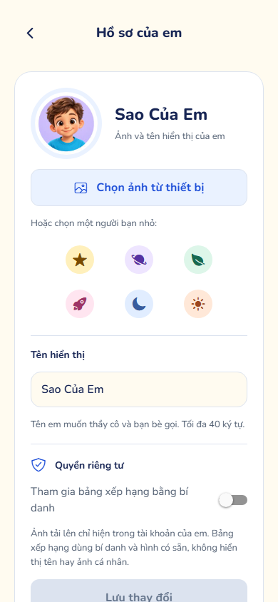

# Hồ sơ riêng từ avatar — 13/11/2026

## Yêu cầu và hành vi

Owner yêu cầu đưa hồ sơ ra khỏi tab “Của em”, mở trang riêng từ avatar, chỉnh tên/hình đại diện, lấy ảnh từ thiết bị và đổi mật khẩu. Nền develop `a3532905488177fca1f29b7b65de3c8397b0b9a9` đã chứa bản 1.0.2 tích hợp Four-L/Nam và đã được triển khai, nghiệm thu dịch vụ thật. Lượt này giữ nguyên tác giả/lịch sử nguồn và không thay OCR, giọng hoặc game.

- Avatar ở trang chủ, bài học, thành tích và Của em mở `/account`. Trang có Back, phiên riêng và responsive hai cột trên desktop. Tab Của em chỉ giữ bài đã lưu, bài làm, ghi chú và lối chơi luyện tập; hạng/nhiệm vụ vẫn ở Thành tích.
- Trang riêng chỉnh tên, chọn sáu avatar hoặc chọn/cắt ảnh từ thiết bị; hiển thị lớp học ở dạng chỉ đọc do giáo viên quản lý. Không thu thêm ngày sinh/địa chỉ hoặc hiển thị email thử nghiệm.
- Tên/ảnh được lưu backend, sống qua reload; ảnh chọn phản ánh ở avatar header. Chọn lại avatar có sẵn xóa ảnh đã tải lên trong cùng transaction cập nhật hồ sơ.
- Tùy chọn bảng xếp hạng dùng bí danh và avatar có sẵn. Ảnh cá nhân chỉ nằm trong phản hồi hồ sơ của chính Student, không xuất hiện ở DTO bảng xếp hạng.
- Đổi mật khẩu yêu cầu mật khẩu hiện tại, mới tối thiểu 8 ký tự/tối đa 72 byte UTF-8, xác nhận khớp, không dùng lại mật khẩu hiện tại. Chặn sau 5 lần sai trong 15 phút; không retry ngầm. Server thu hồi access/refresh cũ và mã reset chưa dùng, cấp cặp phiên mới cho thiết bị hiện tại. Tài khoản Google/Facebook đổi mật khẩu tại dịch vụ đã liên kết.

## Hợp đồng, dữ liệu và kiểm soát

Migration cộng thêm `V33__student_account_photos.sql`, không sửa V30–V32 đã phát hành. Lưu tối đa một thumbnail JPEG 256×256 mỗi Student trong DB; không tạo URL ảnh công khai, object mồ côi hoặc ảnh trên localStorage. Endpoint PUT `/api/v1/student/profile/photo` lấy identity từ principal, giới hạn 5 MB và 16 triệu pixel trước decode, chỉ nhận nội dung PNG/JPEG, crop/re-encode bỏ metadata và vị trí. Client dùng ImagePicker/ImageManipulator sẵn có, giữ PNG khi thu nhỏ để ảnh trong suốt không thành nền đen; server chuyển JPEG nền trắng.

POST `/api/v1/student/profile/password` nằm trong matcher STUDENT hiện có, trả phiên mới no-store. Khóa root user cùng cơ chế refresh/revoke để tránh cạnh tranh; lưu counter thử sai trong DB, không log mật khẩu. Frontend native và web đều kiểm session revision, dùng CAS của tokenStorage khi nhận cặp token mới, hủy request/trạng thái khi rời trang hoặc đổi tài khoản. Lỗi mất phản hồi không khẳng định chắc chắn mật khẩu chưa đổi.

## Kiểm chứng trước PR

| Kiểm tra | Kết quả |
|---|---|
| Student typecheck, lint, contracts | Đạt; lint có một warning QuizInvitation có sẵn; contracts 15/15 |
| Student Jest | 120 suites, 1.493/1.493 đạt |
| Browser Student trên export thật | 29 đạt, 1 orientation desktop skip đúng điều kiện |
| Hai luồng account desktop/mobile | 4/4 đạt: lưu tên/ảnh, reload, chọn preset, xác nhận mật khẩu, lỗi hiện tại, phiên mới và logout |
| Backend toàn suite | 606 tổng, 0 fail, 4 opt-in/environment skip; 602 chạy đạt |
| PostgreSQL 16 thật | V28→V33, V31→V33, V32→V33 đều đạt; checksum, dữ liệu cũ và ảnh mới giữ qua backup/restore |
| Trình duyệt + Spring + PostgreSQL local thật | Đạt, không mock HTTP: upload ảnh trả JPEG, tên/ảnh giữ sau reload, mật khẩu cũ/refresh/access bị từ chối, phiên hiện tại vẫn reload được, avatar có sẵn xóa ảnh |
| Responsive | 320/390/768/1280 không tràn ngang trong nghiệm thu live |

Backend integration còn kiểm: 401 khi chưa đăng nhập, 403 Teacher upload, Student khác không có ảnh của người tải; MIME giả/SVG, giới hạn bytes và PNG khai báo 100 triệu pixel bị từ chối trước decode; đúng mật khẩu, tài khoản liên kết, giới hạn UTF-8, số lần sai có lưu lại/khôi phục sau khoảng chờ; tài khoản khác giữ nguyên mật khẩu.

Browser fixture không phải chứng minh backend RBAC/chuẩn hóa ảnh. Live dùng tài khoản/ảnh minh họa riêng, sau nghiệm thu tài khoản bị disable; không đổi mật khẩu tài khoản thật hoặc tạo thành tích giả cho học sinh.

Lượt main 1.0.2 có một lần runner không bind được cổng browser 43170 (đã đạt khi chạy lại). Đổi cổng test mặc định xuống 23170 để tránh vùng cổng ephemeral Linux; vẫn strictPort và không dùng lại server ngoài test. Không thay cổng ứng dụng hoặc bỏ assertion.

## Phát hành và giới hạn

Qua feature PR → develop → release/1.1.0 → main; chỉ deploy khi CI đúng revision đạt. Backup DB/cấu hình rồi nâng backend V33 trước khi publish Portal/Student. Giữ AI/worker và các container dữ liệu/dịch vụ khác vì source của chúng không thay. Rollback ảnh backend/Portal trước phát hành, giữ migration cộng thêm và dữ liệu; không restore đè DB đang có dữ liệu mới.

Theo yêu cầu owner, lần này dùng web; mobile viewport và Android export không phải nghiệm thu lại điện thoại vật lý. Chọn ảnh trên thiết bị/native cần kiểm thêm khi có thiết bị. Không coi CI xanh là mọi tình huống trên mọi máy đều không thể lỗi.

Npm audit hiện gắn advisory malware với tên `portal-web` trùng gói registry; đây là workspace `private: true`, lockfile trỏ liên kết nội bộ `apps/portal-web`, không tải gói registry đó. Không mass-rename hoặc tắt audit để giấu cảnh báo. `deepmerge` còn cảnh báo mức thấp trong cây Jest phát triển, chưa có bản vá; không đổi major Expo/Jest chỉ để đổi số cảnh báo.

## Skills Applied

- `ui-ux-pro-max`
  - SKILL.md: `.agents/skills/ui-ux-pro-max/SKILL.md`
  - Why selected: Trang riêng cần bố cục và tương tác phù hợp học sinh.
  - Applied to: Giữ token/font hiện có, hai cột desktop, avatar 3×2 trên điện thoại, phân cấp form và khoảng chạm.
- `vercel-react-best-practices`
  - SKILL.md: `.agents/skills/react-best-practices/SKILL.md`
  - Why selected: Trạng thái React/Expo và phiên bất đồng bộ.
  - Applied to: Header avatar, route account, cancellation, refresh tên và CAS phiên mới.
- `fixing-accessibility`
  - SKILL.md: `.agents/skills/fixing-accessibility/SKILL.md`
  - Why selected: Form tên/mật khẩu, nút avatar và xác nhận logout.
  - Applied to: Nhãn, expanded/selected, helper/error liên kết, password manager/paste và trạng thái lưu.
- `mathvision-backend`
  - SKILL.md: `.agents/skills/mathvision-backend/SKILL.md`
  - Why selected: API ảnh và mật khẩu cần quyền sở hữu/persistence đúng.
  - Applied to: Principal, thumbnail, transaction, JWT/refresh, V33 và PostgreSQL upgrade.
- `mathvision-review`
  - SKILL.md: `.agents/skills/mathvision-review/SKILL.md`
  - Why selected: Thay đổi dữ liệu riêng tư và bảo mật Student.
  - Applied to: Ảnh không công khai, phiên cũ/tài khoản khác, mật khẩu và hợp đồng tương thích.
- `mathvision-quality`
  - SKILL.md: `.agents/skills/mathvision-quality/SKILL.md`
  - Why selected: Kiểm thử browser/native/backend và evidence đúng môi trường.
  - Applied to: Hồi quy, ảnh UI, API thật và backup/restore.
- `mathvision-workflow`
  - SKILL.md: `.agents/skills/mathvision-workflow/SKILL.md`
  - Why selected: Nối yêu cầu mới vào phát hành đã được owner cho phép.
  - Applied to: Git Flow, revision, rollout và rollback.
- `ponytail`
  - SKILL.md: `.agents/skills/ponytail/SKILL.md`
  - Why selected: Dùng lại component, thư viện và cơ chế phiên đã có.
  - Applied to: Bỏ ProfilePanel cũ, giữ bảng xếp hạng và dùng thumbnail DB có giới hạn, không thêm dependency.
