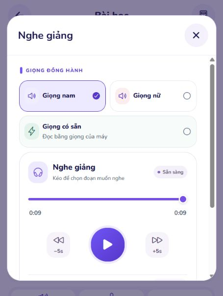

# Kiểm tra và sửa web MathVisionKid

Kiểm tra ngày 03–04/11/2026. Checkout được chạy và sửa: `E:\MathVisionKid`, nhánh `main`, HEAD ban đầu `f1c4bb20498922a99f0346605490f37060fd0f57`.

## Kết quả

Đã sửa các lỗi tái hiện được ở Portal, Teacher, Admin và cấu hình khởi động dùng chung. Web Student đã mở được bài mới và trình phát của cả giọng nam, giọng nữ sau khi sửa xác thực nội bộ. Không thay mã nguồn Student Mobile, thuật toán giải, OCR hoặc mô hình AI trong đợt này. Không commit hoặc push.

Đây là kết quả của các ca kiểm tra bên dưới; không phải cam kết mọi bài toán, mạng, nhà cung cấp giọng và mọi thiết bị đều không bao giờ lỗi.

## Lỗi nghiêm trọng tìm thấy khi chạy thật

### Health xanh nhưng chuẩn bị bài thất bại

Tái hiện trước khi sửa: Spring trả lỗi cho yêu cầu tạo bài; nhật ký ghi upstream `401`. Cổng health thông thường vẫn báo dịch vụ hoạt động. Các tiến trình đã lấy `INTERNAL_API_KEY` từ những nguồn cấu hình khác nhau, nên mở cổng thành công không đồng nghĩa hai dịch vụ xác thực được với nhau.

Đã sửa launcher để Spring, FastAPI và worker kế thừa cùng khóa nội bộ, giữ khóa ngoài tiến trình Vite. Thêm kiểm tra endpoint có xác thực trước khi báo hệ thống sẵn sàng. Chẩn đoán hiện trả `BLOCKED` khi thiếu khóa và `FAIL` khi xác thực bị từ chối; các cổng đang mở không thể che hai trạng thái này.

### Biến môi trường bị khôi phục sai sau một lần chạy

Đã kiểm tra trực tiếp trên máy: gọi `.NET SetEnvironmentVariable` với `$null` từ PowerShell có thể tạo chuỗi rỗng, trong khi xóa qua provider `Env:` mới khôi phục đúng trạng thái không tồn tại. Loader coi chuỗi rỗng là giá trị cha đã cấu hình, nên lần scope tiếp theo không đọc lại dotenv. Đây là nguyên nhân chẩn đoán riêng chạy được nhưng khi đi qua launcher lại báo thiếu cấu hình.

Đã sửa khôi phục biến không tồn tại bằng `Remove-Item Env:...`; vẫn tôn trọng giá trị cha được cung cấp rõ ràng. Kiểm thử bổ sung chạy hai scope liên tiếp, kiểm tra kế thừa ở tiến trình con, dọn biến khi thành công/thất bại và phân biệt chính xác `null` với chuỗi rỗng. Qua cả PowerShell 7 và Windows PowerShell.

### PORT của công cụ khác ảnh hưởng dịch vụ

Launcher hiện cô lập PORT=8000 cho AI/worker/chẩn đoán và truyền rõ cổng 8080 cho Spring. Sau scope, giá trị cha được khôi phục. Chỉ khởi động lại tiến trình đã xác minh thuộc checkout này khi mã/cấu hình mới hơn tiến trình đang chạy.

## Các lỗi web đã sửa

| Khu vực | Trước khi sửa | Sau khi sửa |
|---|---|---|
| Teacher: danh sách lớp/bài/đợt chấm | Lỗi tải bị biến thành danh sách rỗng | Hiện lỗi và nút thử lại; không thông báo nhầm chưa có dữ liệu |
| Teacher: dashboard | Một API lỗi có thể làm mất cả số liệu và danh sách | Các truy vấn độc lập; từng phần có trạng thái lỗi/thử lại |
| Teacher: tạo bài | Link từ lớp không giữ lớp đã chọn; có thể gửi lặp | Giữ classId trong URL, chọn lớp thuộc tài khoản, khóa gửi đồng bộ |
| Teacher: tạo đợt chấm | Phụ thuộc location.state; tải lại trang mất bài đã chọn | Chọn bài từ dữ liệu backend, giữ assignmentId trong URL, tải lại giữ được lựa chọn |
| Teacher: đổi bài khi có ảnh | Có nguy cơ lẫn danh sách học sinh và ảnh giữa các bài | Không cho đổi khi còn bản nháp/đang tải; reset phần upload theo bài |
| Teacher: ảnh đã che | Tệp JPEG xuất ra có thể mang tên/MIME của ảnh gốc | Tên và MIME khớp JPEG; kiểm tra định dạng, dung lượng từng ảnh và tổng tải |
| Teacher: upload thất bại không rõ kết quả | Bấm lại có thể tạo thêm đợt chấm | Giữ ID đợt đã tạo, dẫn tới kiểm tra đợt; không tự gửi lại mù |
| Teacher: che thông tin | Tọa độ vùng che có thể lệch khi canvas đổi kích cỡ | Lưu tọa độ theo ảnh gốc, chuyển đổi theo kích thước canvas, hỗ trợ chuột/chạm/bàn phím |
| Teacher: trình sửa ảnh | Load ảnh cũ có thể ghi đè ảnh mới; preview URL không được thu hồi đầy đủ | Bỏ qua lần load cũ, thu hồi URL, hiện lỗi tải/xuất ảnh; giữ vùng che đã lưu khi sửa bổ sung |
| Teacher: điều chỉnh điểm | Xóa điểm bị điền lại; có thể lẫn bản ghi khi đổi trang | Chỉ điền khi bấm sửa; reset theo submission; kiểm tra điểm hữu hạn, trong giới hạn backend và có lý do |
| Teacher: xác thực | Refresh đồng thời/đổi tài khoản có thể ghi hoặc xóa phiên mới | Dùng một refresh chung, kiểm tra danh tính phiên, từ chối phản hồi cũ, có timeout |
| Teacher: đăng xuất | Có thể phải chờ mạng; hết phiên kẹt kiểm tra đăng nhập | Xóa dữ liệu riêng ngay, rời trang; thu hồi token cũ với thời gian chờ hữu hạn |
| Teacher: URL không hợp lệ | Có thể ra trang trống | Chuyển về dashboard trong phần đã xác thực |
| Portal: biểu mẫu | Một số thao tác gửi lặp; thiếu cấu hình social có thể giữ khóa gửi | Khóa gửi và luôn giải phóng; kiểm tra cấu hình trước khi khóa |
| Portal: chuyển cổng | Phản hồi đến muộn sau rời trang/đổi tài khoản có thể tác động phiên mới | Hủy yêu cầu khi unmount, kiểm tra danh tính phiên trước khi xử lý |
| Portal: thông báo | Có thông báo kỹ thuật về cấu hình dịch vụ | Thông báo ngắn, phù hợp người dùng |
| Admin: bộ lọc tài khoản | Back/Forward không khôi phục đúng bộ lọc | Vai trò/trạng thái/trang đồng bộ URL và lịch sử trình duyệt |
| Cấu hình web mới clone | Ví dụ Teacher/Admin mặc định mock | Ví dụ mặc định dùng API thật; máy local cũng tắt mock để kiểm tra dữ liệu thật |

Giảm số lần retry truy vấn Teacher từ mặc định xuống 1 và đặt timeout cho API/refresh để tránh kéo dài lỗi. Không bỏ xác thực backend hoặc bỏ kiểm chứng toán để làm giao diện báo thành công giả.

## Kiểm thử tự động

| Nhóm | Kết quả |
|---|---|
| Teacher `test:config` | 31/31 qua |
| Portal `test:config` | 33/33 qua |
| Admin `test:config` | 34/34 qua |
| Teacher production bundle | 2/2 qua |
| Portal production bundle | 2/2 qua |
| Admin production bundle | 5/5 qua |
| Student toàn bộ Jest, `--runInBand` | 114 suite; 1.331/1.331 qua, 357,643 giây |
| Student contracts | 15/15 qua |
| Chẩn đoán xác thực tutor | 4/4 qua |
| PowerShell local-env | Các nhóm kiểm tra qua trên PowerShell 7 và Windows PowerShell |
| TypeScript + production build | Teacher, Admin, Portal đều thành công |
| Lint | Admin/Portal sạch; Teacher không có lỗi, còn một cảnh báo Fast Refresh về file xuất cả context hook và component |
| `git diff --check` | Qua; Git có nhắc chuyển LF/CRLF ở một số file |

Các ca mới bao phủ lỗi tải danh sách, lựa chọn bài qua URL, MIME ảnh đã che, chống gửi lặp, lỗi upload không rõ kết quả, tọa độ che sau resize, refresh đồng thời, phiên cũ không ghi/xóa tài khoản mới và hủy chuyển cổng.

Lần chạy Student đầu khi nhiều build đang chạy cùng lúc có 1 test vượt timeout 5 giây; chạy riêng file đó đạt 68/68. Lần chạy toàn bộ cuối đạt 1.331/1.331. Không đổi timeout hay sửa test để che lần thất bại ban đầu.

Production build dùng các origin HTTPS mẫu trong môi trường tiến trình để xác minh cấu hình đóng gói. Đây không phải một lần deploy, cũng không chứng minh đã có cấu hình production thật.

Nhật ký kiểm thử giữ tại `C:\Users\Admin\.codex\tmp\web-audit-20261103\` với các file `teacher-final-tests.log`, `portal-final-tests.log`, `admin-tests.log`, `student-final-tests.log`, `student-contracts.log`, `teacher-final-build.log`, `portal-final-build.log`, `admin-build.log`, `launcher-final.log`.

## Kiểm tra web đang chạy

- Đăng nhập Teacher từ Portal sang cổng giáo viên bằng backend thật; mở chọn bài cho đợt chấm, tải lại URL vẫn giữ bài.
- Teacher đăng xuất về trang công khai.
- Đăng nhập Admin; đổi vai trò ở bộ lọc người dùng rồi Back khôi phục được bộ lọc trước; đăng xuất về trang công khai.
- Đăng nhập Student vào `/study/`, không gặp Unmatched Route.
- Sau bản sửa xác thực, thử bài mới về 16 chiếc bút chì và thêm 3 chiếc: bước học đầu mở được. Cả giọng nữ và nam tải được thời lượng 9 giây; bấm Phát chuyển trạng thái sang Đang phát. Chuyển nữ sang nam trong lần kiểm tra này cho trạng thái Sẵn sàng ngay ở lần quan sát sau thao tác.
- Ảnh bên dưới được chụp sau khi trình phát hoàn tất đoạn đọc. Quan sát UI xác nhận trình phát hoạt động; không thay thế kiểm tra nghe bằng tai trên điện thoại thật.
- Launcher cuối báo PASS cho Docker, PostgreSQL, MinIO, Redis, Spring, FastAPI, xác thực tutor, Celery, Portal, Teacher, Admin; tổng hợp READY_FOR_CORE_DEMO. Metro chưa khởi động trong đợt kiểm tra web này.

Trong nhật ký của lượt bài mới, endpoint bài học trả 200 trong 274 ms; hai endpoint lấy narration trả 200 trong 38 và 44 ms sau giai đoạn chuẩn bị. Đây chỉ là thời gian xử lý từng HTTP request phía Spring, không phải toàn bộ thời gian tạo giọng, không chứng minh mục tiêu 1–3 giây cho mọi lần chưa cache.

## Giới hạn và việc còn có thể tối ưu

- Chưa có xác nhận trên thiết bị Android/iOS thật trong đợt này; không tuyên bố đã kiểm tra phần cứng âm thanh, micro hay chất lượng nghe của mọi giọng thiết bị.
- Kiểm tra tương tác thật có dùng bài toán mới nhập bằng văn bản; không dùng nó làm bằng chứng OCR mọi loại ảnh đều đúng.
- Chưa chạy thử tải nhiều người đồng thời hoặc đưa ra percentile độ trễ. Độ trễ mạng và nhà cung cấp giọng vẫn có thể gây chờ/lỗi; sửa xác thực và UI không loại bỏ được mọi nguyên nhân bên ngoài.
- Các bundle chính vẫn lớn: Teacher 786,78 kB / gzip 241,09 kB; Admin 772,25 / 240,58 kB; Portal 722,02 / 220,78 kB. Có thể tách route/module theo nhu cầu trong một đợt tối ưu riêng; không chỉnh ngưỡng cảnh báo để che số liệu.
- Mỗi máy vẫn cần điền cấu hình dịch vụ và khóa hợp lệ theo mẫu. Không đưa bí mật local vào Git để ép hai máy giống nhau.
- Không chạy toàn bộ kiểm thử backend/AI vì không thay mã nghiệp vụ ở hai phần đó; đã kiểm tra endpoint có xác thực và luồng web thật liên quan.

## Skills Applied

- `ponytail`
  - SKILL.md: `.agents/skills/ponytail/SKILL.md`
  - Why selected: Sửa lỗi với thay đổi tập trung, dùng cơ chế sẵn có, tránh thêm dependency.
  - Applied to: Loader môi trường, xử lý lỗi/timeout và quy trình upload.
- `vercel-react-best-practices`
  - SKILL.md: `.agents/skills/react-best-practices/SKILL.md`
  - Why selected: Các web đều dùng React; cần kiểm soát truy vấn và phản hồi bất đồng bộ.
  - Applied to: React Query, cleanup effect, chống phản hồi cũ, session và reset bản nháp.
- `fixing-accessibility`
  - SKILL.md: `.agents/skills/fixing-accessibility/SKILL.md`
  - Why selected: Biểu mẫu và trình che ảnh cần trạng thái rõ, dùng được bằng bàn phím.
  - Applied to: Nhãn/hướng dẫn canvas, thao tác vùng che bằng phím, thông báo lỗi và thử lại.
- `computer-use`
  - SKILL.md: `C:/Users/Admin/.codex/plugins/cache/openai-bundled/computer-use/26.1027.51404/skills/computer-use/SKILL.md`
  - Why selected: Đối chiếu mã và kiểm thử tự động với giao diện web thật.
  - Applied to: Đăng nhập/chuyển cổng, lọc Admin, chọn bài Teacher và trình phát giọng Student qua trình duyệt.
